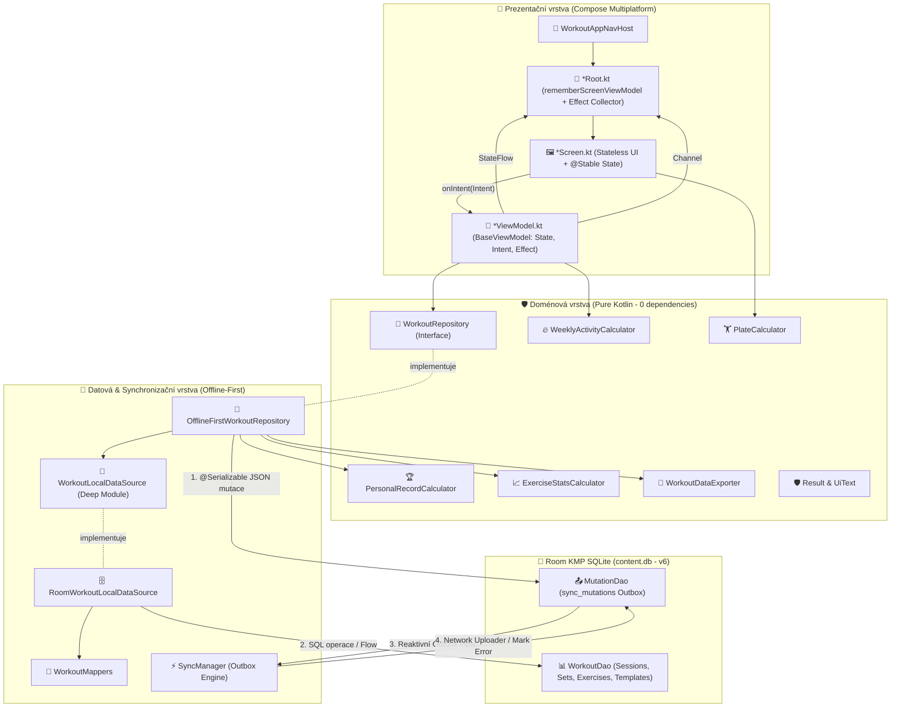

# 🏋️⚡ ContentApp: OmniSync Workout Tracker (Hevy Styl) 🏆📱

> **Prémiový referenční projekt Kotlin Multiplatform (KMP) & Compose Multiplatform**  
> Produkčně vytvrzený tréninkový tracker postavený na **čisté 4-vrstvé architektuře**, reaktivním **MVI vzoru**, **offline-first Room KMP SQLite** databázi s transakčním **Outboxem**, plnou podporou **Dark Mode 🌙 i Light Mode ☀️** a deterministickou testovací sadou (63 testů, 100% pass rate).

[](https://kotlinlang.org)
[](https://www.jetbrains.com/lp/compose-multiplatform/)
[%20%7C%20iOS-brightgreen.svg)]()
[-success.svg)]()
[]()

---

## 🎯 Klíčové Funkce & Výbava (Feature Overview) 🚀

- 🏋️ **Aktivní tréninkové sezení (Active Workout):**
  - Reálné zaznamenávání sérií (váha, opakování, RPE 7.0–10.0) s rychlými krokovacími tlačítky (`±2.5 kg`, `±1 rep`).
  - Podpora typů sérií: **Standardní**, **Zahřívací (`W`)**, **Drop série (`D`)** a **Do selhání (`F`)**.
  - Záchrana dat před zničením ViewModelu díky delegaci zápisů do [`ApplicationScope`](file:///Users/yhdista/AndroidApps/ContentApp/composeApp/src/commonMain/kotlin/core/common/ApplicationScope.kt).
- ⏱️ **Inteligentní Rest Timer (Auto-Trigger):**
  - Automatické spuštění odpočtu pauzy po zaškrtnutí série s možností okamžitého přidání času (`+30s`) nebo přeskočení.
  - Zvuková a haptická notifikace při dosažení 0 s na všech třech platformách ([`PlatformFeedback`](file:///Users/yhdista/AndroidApps/ContentApp/composeApp/src/commonMain/kotlin/core/feedback/PlatformFeedback.kt)).
- 🏆 **Automatická detekce osobních rekordů (PR Engine):**
  - Okamžitý přepočet teoretického 1RM (Epleyho vzorec) v doménovém [`PersonalRecordCalculator`](file:///Users/yhdista/AndroidApps/ContentApp/composeApp/src/commonMain/kotlin/features/workout/domain/PersonalRecordCalculator.kt).
  - Vizuální zlatý odznak `🏆 PR` s vyloučením zahřívacích sérií (`WARMUP`).
- 📋 **Tréninkové šablony (Templates):**
  - Výchozí seedované šablony (Push Day, Pull Day, Leg Day) i možnost uložit jakýkoliv odcvičený trénink jako novou šablonu.
- 🏋️ **Kalkulátor kotoučů olympijské činky (Plate Calculator):**
  - Doménový rozpad zátěže na 20kg / 15kg osu s barevným vykreslením kotoučů (25 kg červené, 20 kg modré, 15 kg žluté, 10 kg zelené, 5 kg bílé, 2.5 kg černé, 1.25 kg mikro).
- 📅 **Týdenní kalendář aktivity & Streaks:**
  - Výpočet ISO-8601 Po–Ne s časovými pásmy ([`WeeklyActivityCalculator`](file:///Users/yhdista/AndroidApps/ContentApp/composeApp/src/commonMain/kotlin/features/workout/domain/WeeklyActivityCalculator.kt)).
  - Indikátor nepřerušené série tréninkových dnů (`🔥 X dní streak`).
- 🔍 **Fulltextové vyhledávání v historii:**
  - Okamžité memoizované filtrování tréninků podle názvu tréninku nebo obsažených cviků s rychlým tlačítkem `✕`.
- 📊 **Čisté grafy progrese (Compose Canvas):**
  - Vykreslování křivky 1RM v [`ProgressionChart`](file:///Users/yhdista/AndroidApps/ContentApp/composeApp/src/commonMain/kotlin/features/workout/ui/components/ProgressionChart.kt) pomocí Compose Canvas bez externích 3rd-party knihoven.
- 💾 **Export & Záloha dat:**
  - Export do CSV (kompatibilní s aplikacemi Hevy/Strong a Excelem) i kompletní JSON záloha včetně šablon s kopírováním do systémové schránky ([`PlatformClipboard`](file:///Users/yhdista/AndroidApps/ContentApp/composeApp/src/commonMain/kotlin/core/platform/PlatformClipboard.kt)).
- ☀️🌙 **Prvotřídní duální téma (Light & Dark Mode):**
  - Hluboká temná OLED paleta pro šetření baterie v posilovně.
  - Zářivá, vysoce kontrastní atletická Light Mode paleta splňující WCAG AA 4.5+ s dynamickým přepínačem v `TopAppBar`.

---

## 🏗️ Architektura Systému (System Architecture) 🏛️✨

Projekt striktně implementuje **čtyřvrstvou Clean Architecture** s **reaktivním MVI (Model-View-Intent)** a **Offline-First Room KMP databází**:



---

## 🎨 Design Systém & Témata (Light ☀️ & Dark 🌙)

Aplikace využívá **Atomic Design System** v balíčku [`ui.designsystem`](file:///Users/yhdista/AndroidApps/ContentApp/composeApp/src/commonMain/kotlin/ui/designsystem):
- 🧬 **Nucleus:** Základní tokeny ([`AppColors`](file:///Users/yhdista/AndroidApps/ContentApp/composeApp/src/commonMain/kotlin/ui/designsystem/nucleus/AppColors.kt), [`AppTypography`](file:///Users/yhdista/AndroidApps/ContentApp/composeApp/src/commonMain/kotlin/ui/designsystem/nucleus/AppTypography.kt), [`AppSpacing`](file:///Users/yhdista/AndroidApps/ContentApp/composeApp/src/commonMain/kotlin/ui/designsystem/nucleus/AppSpacing.kt)).
- ⚛️ **Atoms:** Znovupoužitelné prvky ([`StatusBadge`](file:///Users/yhdista/AndroidApps/ContentApp/composeApp/src/commonMain/kotlin/ui/designsystem/atoms/feedback/StatusBadge.kt)).
- 🖼️ **Templates:** Šablona obrazovek [`UniversalScreenTemplate`](file:///Users/yhdista/AndroidApps/ContentApp/composeApp/src/commonMain/kotlin/ui/designsystem/templates/UniversalScreenTemplate.kt) zajišťující:
  - 👆 **Garantované 48dp dotykové zóny** (`minimumInteractiveComponentSize()`).
  - ⌨️ **Korektní zřetězení insets:** `padding(innerPadding).consumeWindowInsets(innerPadding).imePadding()`.
  - 📱 **Ergonomická palcová akční zóna (Thumb Action Zone)** v dosahu jedné ruky.

### 🎨 Porovnání Barevných Palet:

| Prvek / Token | 🌙 Dark Mode (OLED) | ☀️ Light Mode (Athletic) | Kontrast & Účel |
| :--- | :---: | :---: | :--- |
| **Primary** | `#00E5FF` (Neon Cyan) | `#0284C7` (Sky 600) | 💡 4.6:1 kontrast na bílém podkladu (WCAG AA) |
| **Background** | `#090D16` (Deep Black) | `#F8FAFC` (Slate 50) | 📱 Šetření baterie / Čistý denní kontrast |
| **Surface (Karty)** | `#131B2E` (Navy Panel) | `#FFFFFF` (Pure White) | 🎴 Optické oddělení karet od pozadí |
| **Surface Variant** | `#1E293B` (Dark Slate) | `#F1F5F9` (Slate 100) | 🔘 Pozadí tlačítek a input polí |
| **On Background** | `#F8FAFC` (Bílý text) | `#0F172A` (Slate 900) | 📖 Maximální čitelnost textu za jakéhokoliv světla |
| **PR Gold Pill** | `#FBBF24` (Amber text) | `#B45309` na `#FEF3C7` | 🏆 Zlatý odznak nového rekordu |
| **Status Synced** | `#00E676` (Neon Green) | `#16A34A` na `#DCFCE7` | ✅ Zelená fajfka dokončené série a syncu |

---

## 📁 Struktura Zdrojového Kódu (Directory Tree) 🧭📂

```text
ContentApp/
├── composeApp/
│   ├── src/
│   │   ├── commonMain/kotlin/
│   │   │   ├── core/                        # 🛡️ Jádro aplikace (100% KMP)
│   │   │   │   ├── common/                  # AppClock, ApplicationScope
│   │   │   │   ├── database/                # AppDatabase (Room v6), MutationDao
│   │   │   │   ├── di/                      # Koin moduly (core, data, presentation)
│   │   │   │   ├── feedback/                # PlatformFeedback (zvuk, vibrace)
│   │   │   │   ├── platform/                # PlatformClipboard (systémová schránka)
│   │   │   │   ├── result/                  # Result<T, E>, DataError, RootError
│   │   │   │   ├── sync/                    # SyncManager (Outbox Engine)
│   │   │   │   ├── ui/                      # UiText
│   │   │   │   └── viewmodel/               # BaseViewModel, ViewModelLifecycle
│   │   │   ├── features/workout/            # 🏋️ Doména & Funkce tréninku
│   │   │   │   ├── active/                  # 📱 Obrazovka aktivního tréninku (MVI)
│   │   │   │   ├── detail/                  # 📱 Obrazovka detailu tréninku (MVI)
│   │   │   │   ├── history/                 # 📱 Obrazovka historie tréninků (MVI)
│   │   │   │   ├── navigation/              # 🧭 WorkoutNavigation & AnimatedHost
│   │   │   │   ├── domain/                  # 🛡️ Čisté modely & kalkulátory (0 dependencies)
│   │   │   │   ├── data/                    # 💾 Repozitář, Deep DataSource, Mappers, DAO
│   │   │   │   └── ui/components/           # 🎨 Specializované workout komponenty
│   │   │   └── ui/designsystem/             # 🎨 Atomic Design System (Nucleus, Atoms, Templates)
│   │   ├── androidMain/                     # 📱 Android implementace (MainActivity, Room builder, Haptics)
│   │   ├── desktopMain/                     # 💻 Desktop JVM implementace (main.kt, AWT schránka, beep)
│   │   ├── iosMain/                         # 🍏 iOS implementace (AudioServices, UIPasteboard)
│   │   └── commonTest/kotlin/               # 🧪 Deterministická testovací sada (63 unit testů)
│   └── build.gradle.kts                     # ⚙️ Multiplatformní konfigurace (AGP 9, Kotlin 2.2, Room KMP)
└── gradle/
    └── libs.versions.toml                   # 📦 Čistý katalog verzí závislostí
```

---

## 🧪 Testovací Pokrytí & Kvalita (Quality Assurance) 🛡️📊

Projekt disponuje **63 unit testy**, které se spouštějí deterministicky a bleskově (~300 ms):

| Testovací třída | Počet testů | Pokrytá oblast |
| :--- | :---: | :--- |
| 🏆 [`PersonalRecordCalculatorTest`](file:///Users/yhdista/AndroidApps/ContentApp/composeApp/src/commonTest/kotlin/features/workout/PersonalRecordCalculatorTest.kt) | 5 | Epleyho 1RM výpočet, detekce překonání rekordu, okrajové stavy |
| 🏋️ [`PlateCalculatorTest`](file:///Users/yhdista/AndroidApps/ContentApp/composeApp/src/commonTest/kotlin/features/workout/PlateCalculatorTest.kt) | 5 | Rozpad zátěže na olympijskou osu, 20 kg vs. 15 kg osa, mikro-kotouče |
| 📅 [`WeeklyActivityCalculatorTest`](file:///Users/yhdista/AndroidApps/ContentApp/composeApp/src/commonTest/kotlin/features/workout/WeeklyActivityCalculatorTest.kt) | 4 | Výpočet dnů Po–Ne, posun časových pásem, výpočet souvislé série (streak) |
| 📈 [`ExerciseStatsCalculatorTest`](file:///Users/yhdista/AndroidApps/ContentApp/composeTest/kotlin/features/workout/ExerciseStatsCalculatorTest.kt) | 4 | Celkový objem, odhadované maximum, historická progrese |
| 📤 [`WorkoutDataExporterTest`](file:///Users/yhdista/AndroidApps/ContentApp/composeApp/src/commonTest/kotlin/features/workout/WorkoutDataExporterTest.kt) | 4 | Formátování CSV pro Hevy/Excel, JSON strukturovaný export včetně šablon |
| 🛡️ [`ResultTest`](file:///Users/yhdista/AndroidApps/ContentApp/composeApp/src/commonTest/kotlin/core/result/ResultTest.kt) | 5 | Typově bezpečný Result wrapper, mapování chyb, asEmptyDataResult |
| 🔄 [`SyncManagerTest`](file:///Users/yhdista/AndroidApps/ContentApp/composeApp/src/commonTest/kotlin/core/sync/SyncManagerTest.kt) | 4 | Outbox fronta, simulace offline výpadku, strop pokusů (`MAX_RETRIES = 5`) |
| 🧠 [`ActiveWorkoutViewModelTest`](file:///Users/yhdista/AndroidApps/ContentApp/composeApp/src/commonTest/kotlin/features/workout/ActiveWorkoutViewModelTest.kt) | 12 | Přidání série, změna váhy/reps, auto-trigger rest timeru, typy sérií (`WARMUP`) |
| 📅 [`WorkoutHistoryViewModelTest`](file:///Users/yhdista/AndroidApps/ContentApp/composeApp/src/commonTest/kotlin/features/workout/WorkoutHistoryViewModelTest.kt) | 7 | Načtení historie, týdenní aktivita, fulltextové vyhledávání tréninků i cviků |
| 📋 [`WorkoutDetailViewModelTest`](file:///Users/yhdista/AndroidApps/ContentApp/composeApp/src/commonTest/kotlin/features/workout/WorkoutDetailViewModelTest.kt) | 5 | Zobrazení detailu sezení, uložení jako šablona, výpočet PR |
| 💾 [`WorkoutRepositoryTest`](file:///Users/yhdista/AndroidApps/ContentApp/composeApp/src/commonTest/kotlin/features/workout/WorkoutRepositoryTest.kt) | 8 | Výchozí seed cviků, transakční zápisy, ignorování warmup u PR, Outbox zápis |
| **CELKEM** | **63** | **✅ 100% PASS RATE (~300 ms)** |

---

## 🚀 Jak Projekt Otevřít a Spustit (Quickstart Guide) 💻📱

### 1. Otevření v Android Studio 🛠️
```bash
# Z terminálu:
open -a "Android Studio" /Users/yhdista/AndroidApps/ContentApp
```
Nebo v Android Studio zvolte **File ➔ Open...** a vyberte složku projektu.

### 2. Spuštění na Android Emulátoru / Zařízení 📱
```bash
cd /Users/yhdista/AndroidApps/ContentApp
./gradlew installDebug
adb shell am start -n com.yhdista.contentapp/.MainActivity
```

### 3. Spuštění na Desktopu (macOS / Windows / Linux) 💻
```bash
cd /Users/yhdista/AndroidApps/ContentApp
./gradlew :composeApp:run
```

### 4. Spuštění všech testů a multiplatformní kompilace 🧪
```bash
cd /Users/yhdista/AndroidApps/ContentApp
./gradlew testDebugUnitTest compileKotlinDesktop compileKotlinIosSimulatorArm64 --console=plain
```

---

## 🏆 Licence & Reference 📜✨

Vyvinuto jako vzorová referenční implementace pro **Google Antigravity & Kotlin Multiplatform**. Všechna architektonická rozhodnutí jsou v souladu s globálními standardy `~/.agents/skills/` (`android-compose-ui`, `android-data-layer`, `android-presentation-mvi`, `android-di-koin`, `android-production-architecture`, `rich-documentation`).
