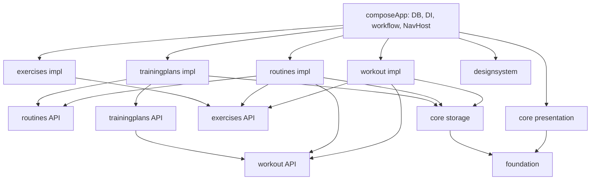

# 🏗️ Architektura a použití POC jako základu

📅 Implementovaný stav po rutinách a cyklických plánech (28. 10. 2026). [MVI průvodce](mvi.md) vysvětluje prezentační tok; [README](../README.md) uvádí spuštění, příkazy a produktová omezení. Původní [rozbor](reviews/2026-10-28-architecture-review.md) a [mesh příprava](reviews/2026-10-28-mesh-preparation.md) jsou historické záznamy.

## 🧱 Hranice modulů



🧱 Každá produktová feature má `api` a `impl`. API vlastní serializovatelné routes, modely a veřejné kontrakty. Implementace vlastní Room adaptér, validaci příkazů a interní ViewModely; veřejné Roots berou callbacky. Cizí DAO ani cizí `impl` do feature nepatří. App smí znát všechny entity, aby sestavila jednu databázi.

🧱 `foundation` zůstává bez Compose, Room a Koin. Obsahuje obecné chyby, čas, aplikační scope, MVI markery a platformní adaptéry. `UiText` a mapování infrastrukturních chyb vlastní `core:presentation` (bez fitness validačních enumů ve foundation); plná lokalizace resources zůstává omezením POC.

🎨 `designsystem` nezná fitness modely ani ViewModely. Nové obrazovky používají Material konstrukce přes `nucleus/LibraryComponents.kt`: vstupy, akce, volby, dialog, page a hlavní záložky. `molecules/EditorNotices.kt` skládá obecné chybové/prázdné stavy. Interaktivní prvky mají min. 48 dp, page zpracuje insets a IME; previews pokrývají obě témata. Starší workout UI stále používá i přímé Material prvky.

## 🗂️ Mapa kódu

```text
foundation/src/commonMain/kotlin/core/       # common, result, mvi, feedback, platform
core/storage/src/commonMain/kotlin/core/    # storage, database, sync, network
core/presentation/src/commonMain/kotlin/core/viewmodel/
designsystem/src/commonMain/kotlin/ui/designsystem/
feature/exercises/{api,impl}/src/commonMain/kotlin/features/exercises/
feature/workout/api/src/commonMain/kotlin/features/workout/domain/
feature/workout/impl/src/commonMain/kotlin/features/workout/
  data/                                    # DAO/entity/mapper/datasource/repository
  active/ history/ detail/ ui/components/  # MVI a fitness UI
feature/routines/{api,impl}/src/commonMain/kotlin/features/routines/
  api/                                     # v API modulu
  data/ presentation/                      # v impl modulu
feature/trainingplans/{api,impl}/src/commonMain/kotlin/features/trainingplans/
  api/ data/ presentation/                  # stejné rozdělení
composeApp/src/commonMain/kotlin/app/
  database/ di/ workflow/ navigation/
composeApp/schemas/app.database.AppDatabase/ # závazné schema6 + schema7
composeApp/src/desktopTest/                  # skutečný Room, migrace, Skia/NavHost
```

## 🧩 Vlastnictví vrstev

| Vrstva | Zodpovědnost | Příklad |
| --- | --- | --- |
| 📱 Screen | stav a callbacky, vykreslení | [RoutineEditorScreen](../feature/routines/impl/src/commonMain/kotlin/features/routines/presentation/RoutineEditorScreen.kt) |
| 🔌 Root | entry ViewModel, lifecycle odběr a navigační callback | stejný soubor jako nový Screen |
| 🧠 ViewModel | UI stav, validace návrhu, příkazy/efekty | [RoutineEditorViewModel](../feature/routines/impl/src/commonMain/kotlin/features/routines/presentation/RoutineEditorViewModel.kt) |
| 🛡️ API | doménové modely/kontrakty, bez Room | [RoutineRepository](../feature/routines/api/src/commonMain/kotlin/features/routines/api/RoutineRepository.kt) |
| 💾 Repository | CAS revize, aktuální reference, agregát a granularní outbox | [RoomRoutineRepository](../feature/routines/impl/src/commonMain/kotlin/features/routines/data/RoomRoutineRepository.kt) |
| 🔗 App workflow | společná transakce více feature | [TrainingWorkflow](../composeApp/src/commonMain/kotlin/app/workflow/TrainingWorkflow.kt) |

## 🔌 DI a životní cyklus

🔌 [Koin.kt](../composeApp/src/commonMain/kotlin/app/di/Koin.kt) skládá platformní databázi/čas/feedback, společný `ApplicationScope`, singleton `RoomCommandCoordinator`, `DraftStore`, `OrderedDrafts`, datové feature moduly a prezentační factories. Routiny dostávají úzký `RoutineUsage`; app implementace počítá dotčené nearchivované plány, každý pouze jednou i při více slotech stejné rutiny.

♻️ [rememberScreenViewModel](../core/presentation/src/commonMain/kotlin/core/viewmodel/ViewModelLifecycle.kt) používá `LocalViewModelStoreOwner` poskytnutý nav entry a Koin factory. Odchod z kompozice nečistí vlastní soukromý store. Dvě entry mají dvě instance; návrat použije původní a skutečný pop ji vyčistí. Procesní rekreace načte business data a editorový draft z DB.

🧠 BaseViewModel zůstává ve `core:presentation`. Intenty loguje pouze názvem typu, bez názvů, poznámek, hledání, exportů či JSON payloadů. Writer loguje pouze typ výjimky, nikoli její zprávu.

## 🏋️ Vlastnictví katalogu

`ExerciseCatalog.create/update/archive` vlastní validaci, generování nových ID a jeden granularní outbox záznam ve stejné transakci jako uživatelskou změnu. Opakovaná archivace je idempotentní. Workout repository tyto příkazy ani seed nevystavuje; vlastní cvik vytváří ActiveWorkout přes veřejné exercises rozhraní. Teprve další samostatný příkaz připojí jeho výskyt s první sérií do workoutu.

`ExerciseCatalogImport` je oddělený integrační vstup pro bundled seed a přijaté vzdálené záznamy se stabilními ID. Tyto záznamy nejsou nové uživatelské mutace a nevracejí se do outboxu. `initKoin` spouští idempotentní inicializaci pouze prázdného katalogu v aplikačním scope; původních sedm výchozích ID i hodnot zůstává zachovaných. Selhání inicializace se zaznamená jako typová infrastrukturní chyba. Schéma se nemění.

## 💾 Příkazy a drafty

🔄 Po vnějším úspěšném commitu RoomCommandCoordinator vyvolá `invalidationTracker.refreshAsync()`: připnutý `useWriterConnection` tuto notifikaci nedělá. Živé Flow odběry tak uvidí změnu bez opětovného otevření obrazovky; savepoint ani rollback neposílají necommitnutý mezistav. Regrese je ověřena skutečným dlouhodobým Room odběrem i návratem na přejmenovaný detail.

💾 [CommandCoordinator](../core/storage/src/commonMain/kotlin/core/storage/CommandCoordinator.kt) řadí celé příkazy v aplikačním scope. Room adaptér otevře writer transaction, vnořené zápisy používají savepoint. Feature nesmí proměnit dílčí `Result.Error` na úspěch vnější transakce; workflow při chybě vyhodí interní abort a přeloží jej až mimo celou transakci.

💾 [OrderedDrafts](../core/storage/src/commonMain/kotlin/core/storage/OrderedDrafts.kt) je druhá, doménově nezávislá aplikační FIFO pro lokální návrhy. `put` přijme snapshot synchronně a vrátí Deferred acknowledgement. Zrušení čekajícího ViewModelu neodstraní přijatý edit. Otevření čeká za staršími zápisy a vrátí aktuální raw payload. Editor získá výhradní lease pro `(kind,id)` vázanou na Job jeho ViewModelu. Druhá entry ani převod workoutu ji nesmí převzít: druhá entry ukáže vysvětlení a Zpět/Retry. Zánik vlastníka uvolní lease až za přijatými autosavy, draft nemaže. Kontrola zrušení před i po čtení brání úniku lease během acquire. Úspěšná publikace/discard lease také uvolní. Generace nadále odmítá pozdní callbacky.

♻️ [DurableEditorController](../core/presentation/src/commonMain/kotlin/core/viewmodel/DurableEditorController.kt) sdílí protokol obou editorů kompozicí: open/lease, feature codec a kontrola verze, autosave ACK, barrier, terminální zámek a publish/discard. Feature factories dodávají namespace, stabilní draftId, typed raw codec a počáteční load; ViewModel dodává validaci/save a prezentační callbacky. ViewModel nezná DraftStore ani pořadí transakčních zápisů. `OrderedDrafts.Session.publish` jako jediný vlastník publikační operace spojí agregát a odstranění návrhu.

💾 Publikace zmrazí vstupy (`isSaving`), zařadí terminal command za autosavy a teprve uvnitř něj otevře transakci: uložit agregát/CAS/outbox → smazat draft → commit → úspěšný efekt. Chyba smazání vrátí zpět agregát i outbox; draft zůstane. Zámek `isSaving` smí uvolnit jen konkrétní terminal operace; starší chyba autosave či usage odběru pouze zobrazí chybu. Fronta se nikdy nečeká zevnitř DB writeru. Discard používá stejné pořadí, chybu ukáže a zůstane v editoru.

📝 Draft payload verze 1 uchovává raw číselné řetězce, původní `expectedRevision`, stabilní ID dětí, pořadí a migrační hodnoty. Text `-` nebo `1.` se nevrací přes validovaný doménový model. Zvolená resume strategie má jeden nový návrh (`new`) a jeden návrh na zdroj (`edit:<id>`, `workout:<sessionId>`), oddělený podle kind `routines`/`trainingplans`. Samostatná knihovna více nových draftů zatím není.

🔄 Nabídky katalogu/rutin mají vlastní dlouhodobý Flow odběr v editorovém ViewModelu. Změna mění jen `choices`/`choicesError`, ne raw draft, jeho child ID, `expectedRevision` ani lease. Archivované odkazy zůstávají čitelné pro opravu, nově je picker nenabízí. Chyba nabídky nesmí odemknout terminal příkaz; `RetryChoices` obnoví jen ukončený odběr i během čekající publikace.

🔒 Save-copy validuje aktuální neuložený obsah, vygeneruje nové aggregate/owned-child ID a ukládá s null expectedRevision; nekopíruje starý repository záznam. Reload přepíše editor až po úspěšném načtení a durable zápisu. Autosave neznamená publikaci, proto je editor stále „rozepsaný“.

## 🏋️ Workout a postup plánu

📋 Start rutiny/aktuálního slotu ukládá samostatný neměnný předpis do `workout_prescriptions`: jeden malý řádek na původní cílovou sérii. [WorkoutPrescriptionSet](../feature/workout/api/src/commonMain/kotlin/features/workout/domain/WorkoutPrescriptionSet.kt) nese původní set ID, workout entry ID, katalogové ID/název/partii, pauzu, původní pořadí cviku a série, váhu/opakování/typ a zdrojová child ID rutiny. Zdroj rutiny/plánu a revize nadále vlastní session. ID cíle odpovídá ID původně vytvořené skutečné série; po jejím smazání zůstává cíli. Opakovaný katalogový cvik má pokaždé jiné entry ID.

🛡️ DAO předpis pouze vkládá s `ABORT`; žádné update/upsert API jej nemění. Nemá FK na editovatelnou rutinu ani odstranitelnou skutečnou sérii/entry. `workout_sets` a `workout_exercises` obsahují skutečnost: delete/renumber/edit/add nemění původní cíle. Dosavadní nullable `prescribed*` sloupce na skutečných sériích zůstávají pomocnou projekcí pro aktivní UI; úplným historickým zdrojem je nový snímek. Legacy a ručně přidaná práce původní předpis nevymýšlí. Předchozí výkon se načte také při startu z rutiny.

🔄 Snapshot, skutečné řádky, session a samostatné typované `workout_prescription` INSERT mutace vzniknou v jedné transakci. Selhání kteréhokoli zápisu vrátí vše zpět. Zrušení celé session odstraní i její snapshot a atomicky přidá existující session DELETE mutaci (sémanticky odstranění celé session včetně dětí); chyba outboxu obnoví i snapshot. Dokončenou session nelze zrušit.

🔗 Veřejné akce `StartRoutineWorkout`, `StartPlanWorkout`, `CompleteWorkout` vlastní workout API; implementace je v app. `Created` otevře workout, `ResumedExisting` nejprve zobrazí zprávu. Existující session se druhým startem nemění. Aktivní obrazovka dokončuje přes `CompleteWorkout`, aby session, posun plánu a outbox sdílely commit.

🗓️ Postup má oddělenou `progressRevision`. Dokončení vyžaduje shodu plan revision, slotu i progress revision; jinak zachová výkon a nastaví `needsReview`. Archivovaný plán už neposouvá. Ruční potvrzení dalšího slotu vymaže review a zvýší revizi. Výběr aktuálního plánu je lokální preference, postup ostatních plánů neresetuje.

📤 Historie sjednotí entry z původních cílů a skutečných sérií: zobrazí i zcela odebraný cvik, cíle označí „Vynecháno — bez skutečného výkonu“. `getPrescriptionForSession` čte úplný předpis; `getSetsForSession` vrací pouze skutečné série. Objem, počty, PR a statistiky se počítají jen ze skutečnosti. JSON export odděluje `prescriptions` a `sets`, propojené stabilním ID; `setsCount` je počet skutečných řádků. CSV má sjednocení ID, pro vynechané cíle `Stav_Skutečnosti=OMITTED` a prázdné skutečné číselné sloupce. Původní pořadí série/cviku a source child ID mají vlastní sloupce, proto přečíslování skutečnosti nefalšuje předpis.

📤 `CreateRoutineDraft` z workout API je app adaptér nad `RoutineDraftFactory`. Zkopíruje skutečné jednotlivé série podle entry/order/type/rest do návrhu. Nepublikuje rutinu ani outbox. CSV/JSON nyní exportují pouze workout data/snapshoty a katalog; definice rutin, plány, postup ani drafty nejsou zálohovány. Legacy template shim byl odstraněn.

## ♻️ Schéma 7 a synchronizace

♻️ [Migrace 6 → 7](../composeApp/src/commonMain/kotlin/app/database/Migrations.kt) převádí templates na rutiny se stejnými aggregate ID, přidává normalizované plans/progress/selection, drafts, workout entries, nullable prescribed/source data a prázdnou tabulku `workout_prescriptions`. Pro staré session zůstává původní předpis neznámý. Verze7 byla před touto finalizací nevydaná; export7 a produkční migrace6→7 byly změněny společně, závazný export6 je byte-for-byte stejný. Neplatné původní scalar hodnoty zůstávají v `LegacyRoutineValues`; editor je zachová při nesouvisející změně a odstraní až explicitním potvrzením opravy. Chybějící katalog má archivovaný placeholder. Historické pořadí workoutu může být jen rekonstruované.

🔄 Staré outbox mutace včetně ID/payloadu zůstávají; legacy typy vyžadují budoucí adaptér. Žádný skutečný cloud uploader není zapojen. Migrace 1–5 ani destruktivní fallback nejsou podporované. Granulární nové mutace neskládají celý agregát do jednoho sync JSON řádku.

## 🧭 Jedna typovaná navigace

🧭 [AppNavHost](../composeApp/src/commonMain/kotlin/app/navigation/AppNavHost.kt) obsahuje devět serializovatelných feature routes pro historii, aktivní workout, detail workoutu, seznam/detail/editor rutin a plánů. Přenášejí pouze ID. `AppTabs` přijímá neutrální `AppTabItem(label, icon)`; popisky, ikony, pořadí Tréninky/Rutiny/Plány i mapování routes vlastní app. Tabs používají framework save/restore; Back z editoru jde přes jediný intent (toolbar i Android system Back). Workout se popne na zdrojový detail. Všechny Root efekty čekají přes `CollectScreenEffects` na `RESUMED` své entry; opožděný commit během odchodu nesmí přesměrovat jinou záložku. Uchovaná entry zpracuje buffered efekt po návratu.

🛠️ V připnuté verzi `org.jetbrains.androidx.navigation:2.8.0-alpha10` neandroidí `NavBackStackEntryState.fromBundle` zahazuje entry s null argumenty. Proto [withRestorableEntries](../composeApp/src/commonMain/kotlin/app/navigation/RestorableGraph.kt) přidá všem destinations včetně root grafu privátní default `_hostEntry=true`. Hlídá kolizi s argumenty; doménové routes argument nepoužívají. Není to vlastní stack. Při upgradu odstranit až po průchodu skutečného host recreation testu.

## 🧪 Ověření a další aplikace

🧪 Common testy feature ověřují modely, ViewModely, chyby, konflikty a raw návrhy. Desktop používá reálný Room/Bundled SQLite pro rollback/CAS/migraci. [TypedNavigationTest](../composeApp/src/desktopTest/kotlin/app/navigation/TypedNavigationTest.kt) ověřuje oddělené entry ViewModely, návrat, pop clear i obnovení argumentů po nové kompozici. [LibrarySmokeTest](../composeApp/src/desktopTest/kotlin/app/navigation/LibrarySmokeTest.kt) vykresluje skutečné Roots/DI/Room přes Desktop Skia v izolované DB a ukládá screenshoty. Testový host poskytuje lifecycle/saveable owner a simulovaný Main dispatcher.

🚀 Při nové feature založ malé API/impl, přidej route a public Root s callbacky, registruj DAO u app databáze a factory u feature modulu. Obecné prvky patří do foundation/storage/presentation/designsystem, produktová rozhodnutí zůstávají ve feature/app workflow. Platformní compile a APK jsou nutné, ale nenahrazují runtime ověření Android Back na zařízení ani iOS host.
