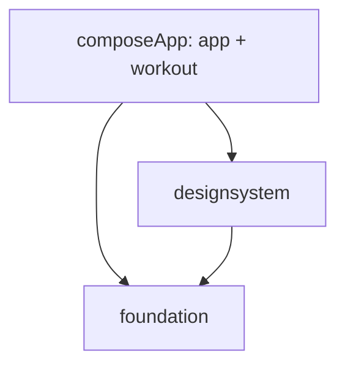

# 🏗️ Architektura a použití POC jako základu

📅 Stav po úpravách z 28. 10. 2026. Tento dokument popisuje implementaci; původní rozbor v `reviews/2026-10-28-architecture-review.md` je historický snímek před opravami.

## 🧭 Jak dokumentaci číst

- 🧭 Tento dokument popisuje moduly, vrstvy, datové záruky, DI a umístění souborů.
- 🧭 [Praktický průvodce MVI](mvi.md) vysvětluje State, Intent, Effect, Root/Screen, konkrétní průchod editací a přidání další obrazovky.
- 🧭 [README](../README.md) obsahuje spuštění a ověřovací příkazy.

## 🏗️ Hranice modulů



🧱 `foundation` obsahuje obecné Kotlin kontrakty a malé platformní adaptéry: čas, schránku, zvuk/haptiku, Result a chyby, MVI markery, formátování a aplikační CoroutineScope. Nezávisí na Room, workout doméně, Compose ani Koin. `UiText` je zatím jednoduchý textový obal s českými chybovými zprávami; lokalizace do resources není vyřešená.

🧱 `designsystem` obsahuje sdílené Compose UI. Barevná paleta odpovídá současnému produktu a při založení jiné aplikace se může změnit; workout obrazovky ani entity sem nepatří.

🧱 `composeApp/app` vlastní DI, složení databáze a navigaci. `composeApp/features/workout` vlastní doménu, prezentaci, mapování, DAO a repository. Prezentační helpery `core/viewmodel` a outbox infrastruktura zatím zůstávají v aplikačním modulu; nesmí se kvůli tomu obracet závislost sdílených knihoven na aplikaci.

🧱 Workout feature zůstává balíčkem v aplikaci. Vynucené Gradle hranice se týkají sdílených knihoven. Další feature Gradle modul má smysl při potřebě samostatné kompilace nebo opětovného použití; není potřeba zakládat modul pro každou třídu.

## 🗂️ Mapa adresářů

🗂️ Následující strom ukazuje významné cesty; vynechává build výstupy a některé jednotlivé soubory. Název Gradle modulu není totéž co Kotlin package: například `foundation` exportuje balíčky začínající `core`.

```text
ContentApp/
├── settings.gradle.kts                  # registrace tří Gradle modulů
├── gradle/libs.versions.toml             # společný katalog verzí
├── foundation/
│   └── src/
│       ├── commonMain/kotlin/core/
│       │   ├── common/                  # AppClock, ApplicationScope, NumberFormatter
│       │   ├── mvi/                     # UiState, UiIntent, UiEffect, MviContract
│       │   ├── result/                  # Result, DataError, safeLocalCall
│       │   ├── ui/                      # UiText a mapování chyb na text
│       │   ├── feedback/                # PlatformFeedback rozhraní
│       │   ├── platform/                # PlatformClipboard rozhraní
│       │   └── model/                   # ItemSyncStatus
│       ├── androidMain/kotlin/core/     # Android adaptéry času, zvuku a schránky
│       ├── desktopMain/kotlin/core/     # JVM adaptéry
│       ├── iosMain/kotlin/core/         # Foundation/UIKit adaptéry
│       └── commonTest/                  # testy Result a bezpečného volání
├── designsystem/
│   └── src/commonMain/kotlin/ui/designsystem/
│       ├── nucleus/                     # AppTheme, AppColors, AppSpacing, AppTypography
│       ├── atoms/feedback/              # StatusBadge, ErrorNotice
│       └── templates/                   # UniversalScreenTemplate
└── composeApp/
    ├── schemas/app.database.AppDatabase/ # verzované Room schéma
    └── src/
        ├── commonMain/kotlin/
        │   ├── app/
        │   │   ├── di/                  # Koin: skládání konkrétní aplikace
        │   │   ├── database/            # AppDatabase, konfigurace, writer koordinátor
        │   │   └── navigation/          # AppNavHost, AppNavigationState, back handling
        │   ├── core/
        │   │   ├── viewmodel/           # BaseViewModel a rememberScreenViewModel
        │   │   ├── database/            # generické outbox entity a DAO
        │   │   ├── sync/                # SyncManager
        │   │   └── network/             # HttpClientFactory; aktuální sync jej nepoužívá
        │   └── features/workout/
        │       ├── domain/              # modely, kontrakty a výpočty
        │       ├── data/
        │       │   ├── dao/             # Room SQL dotazy
        │       │   ├── entity/          # databázové entity
        │       │   ├── mapper/          # Entity ↔ Domain
        │       │   ├── datasource/      # lokální adaptér schovávající Room
        │       │   └── model/           # serializovatelné sync payloady
        │       ├── active/              # Contract, ViewModel, Root, Screen
        │       ├── history/             # Contract, ViewModel, Root, Screen
        │       ├── detail/              # Contract, ViewModel, Root, Screen
        │       └── ui/components/       # prvky závislé na workout doméně
        ├── androidMain/                 # Application, Activity, platformní DI a BackHandler
        ├── desktopMain/                 # main(), platformní DI
        ├── iosMain/                     # platformní DI; samostatný iOS host chybí
        ├── commonTest/                  # výpočty, ViewModely, repository, navigace, sync
        └── desktopTest/                 # integrační testy nad skutečným Room/SQLite
```

🗂️ Repository, export a koordinátorové rozhraní leží přímo v `features/workout/data`, mimo vnitřní adresáře stromu. Seedovací obsah je ve `WorkoutDefaults.kt`.

## 🧩 Odpovědnosti vrstev

| 🧩 Část | Co vlastní | Co do ní nepatří | Příklad |
| --- | --- | --- | --- |
| 📱 Screen | vykreslení, předání uživatelského záměru, drobný lokální vizuální stav | DI, DAO a spouštění datových zápisů | [ActiveWorkoutScreen](../composeApp/src/commonMain/kotlin/features/workout/active/ActiveWorkoutScreen.kt) |
| 🔌 Root | získání ViewModelu, odběr stavu/efektů, propojení navigace a snackbar hostu | SQL a doménová rozhodnutí | [ActiveWorkoutRoot](../composeApp/src/commonMain/kotlin/features/workout/active/ActiveWorkoutRoot.kt) |
| 🧠 ViewModel | UI stav, zpracování intentů, sledování dat, efekty | znalost Room entit a konkrétního AppDatabase | [ActiveWorkoutViewModel](../composeApp/src/commonMain/kotlin/features/workout/active/ActiveWorkoutViewModel.kt) |
| 🛡️ Domain | workout modely, rozhraní, čisté výpočty | Compose, Room, Android UI a Koin | [WorkoutRepository](../composeApp/src/commonMain/kotlin/features/workout/domain/WorkoutRepository.kt), [PersonalRecordCalculator](../composeApp/src/commonMain/kotlin/features/workout/domain/PersonalRecordCalculator.kt) |
| 🔄 Repository | složení celého datového příkazu, kontrola aktuálních dat, tvorba mutací | navigation callbacky a čtení UI state | [OfflineFirstWorkoutRepository](../composeApp/src/commonMain/kotlin/features/workout/data/OfflineFirstWorkoutRepository.kt) |
| 🗄️ LocalDataSource | překlad mezi DAO a doménovými modely, složení lokálních dat | rozhodování o navigaci | [RoomWorkoutLocalDataSource](../composeApp/src/commonMain/kotlin/features/workout/data/datasource/RoomWorkoutLocalDataSource.kt) |
| 💾 DAO + Entity | SQL a reprezentace tabulek | texty obrazovek a Compose | [WorkoutDao](../composeApp/src/commonMain/kotlin/features/workout/data/dao/WorkoutDao.kt) |
| 🔌 Aplikační skládání | výběr implementací, DB, scope, navigační destinace | přenos workout závislostí do foundation | [Koin](../composeApp/src/commonMain/kotlin/app/di/Koin.kt) |

🧩 Doména používá `Flow`, takže „bez UI/framework závislostí“ neznamená „bez knihoven“. Use-case třída pro každé volání zde není: ViewModel volá doménové repository rozhraní přímo a výpočetní pravidla jsou samostatné kalkulátory.

## 🔌 Dependency injection a spuštění

🔌 [Koin.kt](../composeApp/src/commonMain/kotlin/app/di/Koin.kt) skládá:

| 🔌 Koin modul | Registrace | Životnost |
| --- | --- | --- |
| 🔌 `coreModule` | `ApplicationScope` | singleton; při zavření Koin se zruší |
| 🔌 `workoutDataModule` | writer koordinátor, local data source, export, repository, sync | singletony |
| 🔌 `workoutPresentationModule` | tři ViewModely | `factoryOf`: nová instance při požadavku z DI |
| 🔌 `platformModule` | databáze a DAO, AppClock, feedback a clipboard | platformní singletony; databáze má close callback |

🔌 `commonModule` zahrne první tři moduly; `initKoin` přidá platformní modul a zavolá `startSyncLoop()`. Bez uploaderu smyčka frontu nezpracovává.

🔌 Android inicializuje DI v [ContentApplication](../composeApp/src/androidMain/kotlin/com/yhdista/contentapp/ContentApplication.kt) a zobrazí `AppNavHost` z [MainActivity](../composeApp/src/androidMain/kotlin/com/yhdista/contentapp/MainActivity.kt). Desktop provádí inicializaci v [main.kt](../composeApp/src/desktopMain/kotlin/main.kt). Pro budoucí iOS host existuje `initKoinIos()`.

🔌 `factoryOf` neurčuje životní cyklus obrazovky. Ten řeší `rememberScreenViewModel`: vytvoří ViewModelStore, do kterého přes ViewModelProvider jednou získá instanci z Koin. Při běžné rekompozici se používá stejná instance; při odstranění obrazovky z kompozice se store vyčistí.

## 🧠 Tok UI a chyb

🧠 Business vstupy Screen jsou state a onIntent; navíc přijímá prezentační parametry jako Modifier a snackbarHost. Podrobný rozbor s ukázkami je v [MVI průvodci](mvi.md). Root získá ViewModel, pozoruje stav a efekty a zajistí navigaci nebo snackbar. BaseViewModel poskytuje atomickou aktualizaci stavu a `launchOperation`: chyby lokálního úložiště mapuje přes `safeLocalCall`, zatímco CancellationException propouští.

🧠 Repository kontrakt používá suspend operace a výjimky, které prezentace převádí na Result/UiText. Flow může skončit chybou; celá pozorovací operace ji zachytí a nabídne obnovu dat. Kontrakt netvrdí, že každá metoda vrací Result.

🔄 Opakované LoadWorkout/LoadHistory ruší předchozí odběr. Přepnutí statistik ruší předchozí odběr statistik. Stav chyby je vidět na obrazovce a tlačítko „Obnovit data“ načte aktuální stav úložiště; automaticky neopakuje editaci ani mazání.

## 💾 Vlastnictví zápisů

💾 `WorkoutWriteCoordinator` je malé rozhraní, jehož aplikační adaptér `RoomWorkoutWriteCoordinator` vlastní konkrétní databázi a ApplicationScope.

1. 💾 Volající předá celý příkaz do FIFO fronty.
2. 💾 Aplikační worker získá writer connection a otevře IMMEDIATE transakci.
3. 💾 Repository čte aktuální hodnoty přes suspend snapshot dotazy, provede změny a vloží outbox.
4. 💾 Úspěch transakci commitne, chyba ji rollbackne a dokončí výsledek chybou.
5. 💾 Zrušení čekajícího volajícího neruší už přijatý příkaz.

💾 Vnořené repository příkazy používají stejnou transakci. Uvnitř příkazu se nesmí spouštět paralelní práce ani síťové volání. Editační callback musí být čistý a pracovat s předanou aktuální hodnotou; nesmí v sobě držet stav obrazovky.

💾 To řeší odchod z obrazovky, nikoli zaručené dokončení při ukončení procesu. SQLite transakce při přerušení necommitnuté změny vrátí zpět. Pro práci po restartu procesu je nutná perzistentní úloha a platformní strategie.

💾 Aplikační scope a databáze se zavřou při zavření Koin kontextu. Scope vlastní práci celé aplikace; ViewModel jej už neinjektuje.

## 🛡️ Konzistence workout dat

- 🛡️ Start kontroluje existující aktivní session uvnitř stejné transakce jako vložení.
- 🛡️ Start ze šablony zahrnuje session i všechny série; opakované volání nepřidá série do existující session.
- 🛡️ `updateSet(id, update)` načte aktuální řádek a až pak aplikuje změnu. Identita se měnit nesmí.
- 🛡️ Dokončení tréninku spočítá souhrn a uloží stav v jedné transakci. Následné přidávání, úpravy a mazání sérií dokončené session jsou odmítnuté.
- 🛡️ Smazání série zahrnuje i přečíslování zbylých sérií a odpovídající mutace. Odebrání cviku je jedna transakce pro všechny jeho série.
- 🛡️ Uložení šablony zahrnuje hlavičku, cviky a outbox společně.
- 🛡️ `WorkoutDataExport` má oddělený kontrakt a implementaci; formátuje konzistentní snapshot dat mimo transakci.
- 🛡️ `WorkoutDefaults` obsahuje příkladový produktový obsah mimo obecné knihovny.

## 🔄 Synchronizace

🔄 SyncManager se spouští z aplikačního skládání, ne z composable navigace. Výchozí uploader chybí, takže se fronta bez backendu nezpracovává. Žádný náhodný simulátor nepotvrzuje a nemaže uživatelské mutace.

🔄 U nakonfigurovaného uploaderu je retry limit stejný v SQL dotazu a manageru. Počet neodeslaných změn zahrnuje i položky s vyčerpanými pokusy. Nulový počet záznamů v lokálně používané aplikaci se zobrazuje jako „LOKÁLNĚ“, nikoli jako potvrzení cloudové synchronizace. Busy stav se resetuje i při zrušení sync smyčky.

🔄 Tento engine není hotový synchronizační protokol. Před reálným backendem je potřeba doplnit idempotenci, závislosti/pořadí mutací, příjem vzdálených změn, konflikty, obnovu odložených položek, autentizaci a platformní background scheduling.

## 💾 Databáze

💾 Všechny platformy používají společnou konfiguraci BundledSQLiteDriver a IO query context. AppDatabase skládá workout tabulky a generický outbox; tato znalost je vlastnictvím aplikace.

💾 Schéma 6 je exportované. Není potřeba měnit databázovou verzi kvůli přesunu tříd nebo novým dotazům, které nemění tabulky. Destruktivní fallback je odstraněný. Chybějící migrace zachová soubor a vyvolá chybu při otevření; není náhradou za implementovanou migraci.

⚠️ Historické verze 1–5 nemají v repozitáři schémata ani ověřené migrace. Nelze poctivě tvrdit jejich podporu. Před nasazením upgradu na tato zařízení je potřeba získat původní schémata a napsat odpovídající migrace. Pro další verzi se přidá schéma a test upgrade se zachováním dat i outboxu.

## 🧭 Navigace a obnova

🧭 Aplikační navigace drží malý explicitní back stack. Saver ukládá destinace a argumenty; po obnovení obrazovka načte data z repository. Android BackHandler odstraňuje položku ze stacku. Desktop a iOS používají explicitní tlačítka obrazovek; nativní iOS swipe-back není implementovaný.

🧭 ViewModelStore zůstává navázaný na přítomnost obrazovky v kompozici a při jejím opuštění se čistí. Nejde o zachování ViewModelu přes rekreaci hosta. Lokální business data přežijí v databázi, rozepsaný text a odpočet pauzy se zatím přes rekreaci hosta neobnovují. Pro složitější navigaci je vhodné navázat ViewModelStore na navigační entry podporovaného navigačního řešení.

## 🚀 Jak založit další aplikaci

1. 🚀 Zachovat nebo převzít moduly foundation a designsystem. Rozhodnout, zda budou kopírovanou šablonou, nebo společně verzovanými knihovnami.
2. 🚀 V aplikačním modulu změnit identitu aplikace, platformní vstupy, téma a konfiguraci.
3. 🚀 Nahradit workout feature vlastní doménou. Konkrétní entity, seedování a payloady se nepřenášejí do foundation.
4. 🚀 V aplikaci složit databázi a DI a definovat celé transakční příkazy.
5. 🚀 U každé feature ověřit změnu ze starého UI snímku, opakovaný intent, chybu úložiště a odchod z obrazovky během zápisu.
6. 🚀 Síťovou a background infrastrukturu doplnit podle skutečného backendového kontraktu.

🚀 Stávající toolchain zůstává na dosavadním KMP/AGP zapojení s legacy Gradle přepínači. Kompletní migrace Gradle/AGP konfigurace ani plošný upgrade knihoven nebyly součástí tohoto refaktoringu.

## 🧪 Kam patří testy

| 🧪 Co se mění | Vhodné ověření | Existující příklad |
| --- | --- | --- |
| 🧪 čistý výpočet | common unit test s konkrétními vstupy a výsledkem | [PersonalRecordCalculatorTest](../composeApp/src/commonTest/kotlin/features/workout/PersonalRecordCalculatorTest.kt) |
| ⚡ Intent → State/Effect | ViewModel test s řízeným časem a datovou závislostí | [ActiveWorkoutViewModelTest](../composeApp/src/commonTest/kotlin/features/workout/ActiveWorkoutViewModelTest.kt) |
| 💾 transakce, SQL, souběh, zrušení volajícího | skutečný Room a Bundled SQLite | [WorkoutPersistenceTest](../composeApp/src/desktopTest/kotlin/features/workout/WorkoutPersistenceTest.kt) |
| 🧭 obnovení navigačních argumentů | test save/restore a návratu | [AppNavigationStateTest](../composeApp/src/commonTest/kotlin/app/navigation/AppNavigationStateTest.kt) |
| 🔄 odesílání a retry | deterministický injektovaný uploader | [SyncManagerTest](../composeApp/src/commonTest/kotlin/core/sync/SyncManagerTest.kt) |

🧪 Fake DAO dokáže ověřit orchestraci, ale nedokazuje SQL rollback ani migraci. Pro transakční záruku má rozhodující hodnotu integrační test. Aktuální ověřovací příkazy jsou v [README](../README.md).
