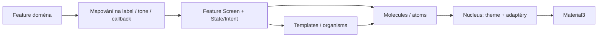

# 🎨 Atomic UI: co sdílíme a kde končí design system

`designsystem` je jeden KMP modul. Atomic vrstvy jsou balíčky uvnitř něj; samostatný Gradle modul pro každé tlačítko by přidal konfiguraci bez užitečné hranice. Produktové obrazovky skládají veřejné komponenty a pracují s `AppStyle`; přímé Material3 konstrukce jsou soustředěné v `nucleus`.

## 🧩 Mapa komponent

| Vrstva | Co vlastní | Konkrétní vstupy |
| --- | --- | --- |
| ⚛️ `nucleus` | theme, barevné a typografické tokeny, interní Material adaptéry | `AppTheme`, `AppStyle`, `AppColorTokens`, `AppTextStyles`, `MaterialAdapters.kt` |
| 🔹 `atoms` | základní akce, text, vstup, plocha a sémantický stav | `AppButton`, `AppAction`, `AppText`, `AppInput`, `AppCard`, `AppToggle`, `StatusBadge` |
| 🧬 `molecules` | drobné interakce složené z více prvků | `AppChoice`, `AppConfirm`, `AppSheet`, `ReorderActions`, `EditorNotice`, `AppMessageHost` |
| 🧱 `organisms` | společná navigace a horní lišta | `AppTopBar`, `AppTabs`, `AppTabItem` |
| 📐 `templates` | struktura stránky, insets, klávesnice, seznam | `AppScreen`, `AppPage` |
| 🏋️ feature UI | produktový obsah, význam a callbacky | workout `SetRowItem`, `ExerciseCard`, grafy; editors rutin/plánů |

🎯 Vrstva vyjadřuje úlohu komponenty. Nemusíš přidávat mezivrstvu jen proto, aby každá obrazovka prošla všemi pěti adresáři. Sdílej stabilní opakovanou interakci; nevytvářej univerzální komponentu s desítkami přepínačů pro dvě odlišné obrazovky.



## 🔌 Veřejný kontrakt

- 🧷 Layout přijímá `Modifier = Modifier` jako první volitelný parametr na svůj kořen. Consumer tak přidá testTag, focus nebo rozměry bez kopírování implementace. Theme provider sám layout nevytváří.
- 👆 Akce používá `ActionVariant` z `ui.designsystem.nucleus` a obsahový slot. `Primary`, `Secondary`, `Quiet` a `Destructive` nesou význam; konkrétní barvy volí téma.
- ⌨️ `AppInput` přijímá raw text, `KeyboardOptions`, `singleLine`, `isError` a `supportingText`. Numerický filtr ani doménová validace se do obecného pole neschovávají.
- 💬 Dialog přijímá texty/sloty potvrzení i zrušení. Text produktu nebo jméno ukládaného modelu vlastní consumer.
- 🧭 `AppTabs` přijímá obsah a ikony. Povinný obsahový slot nese srozumitelný label; `AppTabItem.icon` je dekorativní a jeho vlastní semantics se skryjí, aby čtečka neopakovala popis. Samostatný význam patří do labelu. Routy, pořadí záložek a navigační controller vlastní aplikace.
- 🛡️ `StatusBadge(label = …, tone = …)` zná pouze UI `StatusTone`. `ItemSyncStatus` mapuje feature; design system kvůli němu nepotřebuje foundation, storage ani feature API.
- 🎨 `AppStyle` vystavuje vlastní sadu barev a Compose `TextStyle`. Veřejný kontrakt nevyžaduje Material `ColorScheme` ani `Typography`.

Příklad uvnitř feature Screen:

```kotlin
import ui.designsystem.nucleus.ActionVariant

AppCard(modifier = Modifier.testTag("routine-name")) {
    AppInput(
        label = "Název rutiny",
        value = state.draft.name,
        enabled = !state.isSaving,
        isError = state.nameError != null,
        supportingText = state.nameError,
        onChange = { name -> onNameChanged(name) }
    )
    AppButton(
        onClick = onSave,
        enabled = !state.isSaving,
        variant = ActionVariant.Primary
    ) { AppText("Uložit") }
}
```

📝 Ukázka ilustruje API, nikoli nový závazný typ State. Skutečný Screen předává změnu intentem své feature; raw model, validace i uložení zůstávají mimo design system.

## ♿ Přístupnost a pružné rozložení

- 👆 Interaktivní plocha má minimálně 48 dp. Icon-only akce má popis účelu; dokončení série vystavuje checked state a popisek.
- 🎨 Stavové tokeny oddělují `content/container` od `accent/onAccent`. Textová barva se neposuzuje samostatně: test měří kontrast konkrétní dvojice v obou tématech, pro běžný text alespoň 4,5 : 1.
- 🔎 Šířka 320 dp a `fontScale = 2` mají vlastní komponentové testy. Výška se může zvětšovat; pole se při malém prostoru řadí pod sebe.
- 🧭 Záložky při velkém písmu nebo malé šířce přejdou na celé řádky s ikonou a popiskem. Při běžné velikosti zůstávají vedle sebe. Test kontroluje skutečné vykreslené řádky textu, rozměry a callback výběru.
- 🏋️ Řádek série zachovává kompaktní dvě řady při dostatku místa; při velkém písmu dává popsaná pole pod sebe. Toto rozhodnutí patří workout UI, protože zná váhu, opakování a RPE.
- 🖼️ Screenshoty jsou důkaz kontrolovaného scénáře. Nejde o pixelové golden testy ani tvrzení, že každá budoucí obrazovka bude automaticky přístupná.

## 🧪 Jak hlídat další rozšiřování

[Veřejný consumer](../verification/designsystem-consumer/src/commonMain/kotlin/verification/PublicDesignSystemConsumer.kt) sestavuje komponenty bez vlastní deklarace Material, foundation, storage nebo feature závislostí. Zachytí chybu, kdy veřejné API nepřímo vyžaduje typ z nepřístupné knihovny. Samotná úspěšná kompilace aplikace takovou chybu snadno skryje, protože aplikace už závislost má.

[Komponentové testy](../designsystem/src/desktopTest/kotlin/ui/designsystem/DesignSystemAccessibilityTest.kt) ověřují kontrast, čitelnost velkého textu a interakce. [Workout test](../feature/workout/impl/src/desktopTest/kotlin/features/workout/ui/components/SetRowAccessibilityTest.kt) pokrývá sémantiku dokončení i rozložení série. Integrační testy skutečných Roots a NavHostu zůstávají v `composeApp`.

🔧 Přidáváš komponentu pro další aplikaci? Začni konkrétním druhým použitím. Přesuň společný vizuální a interakční kontrakt; data, názvy domény a rozhodnutí o zápisu nech u feature. Přidej kontrolu veřejného consumeru a cílený test chování, které by se mohlo regresí ztratit.
