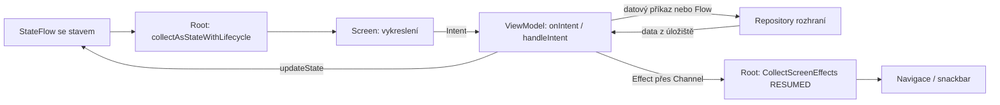
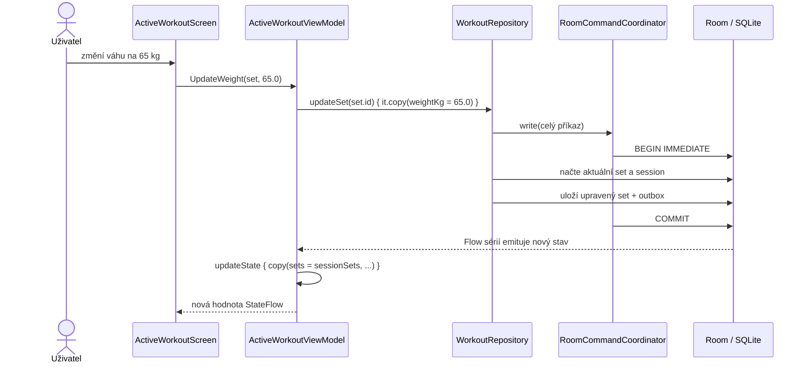
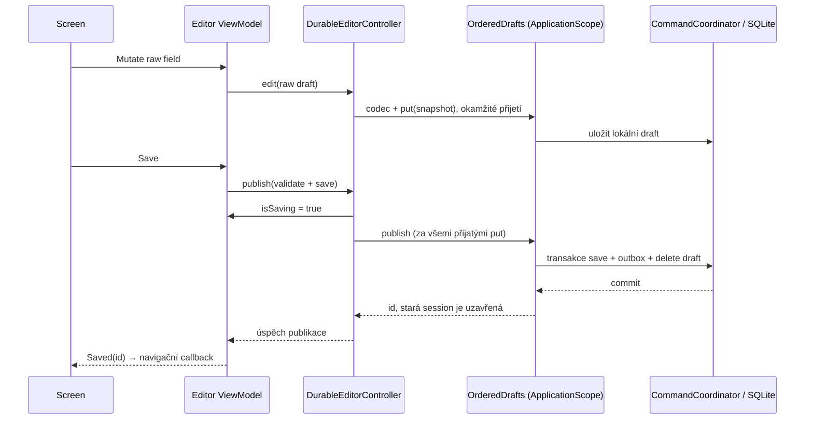

# 🧠 Praktický průvodce MVI v ContentApp

📚 Tento průvodce popisuje současný kód, nikoli obecnou představu o MVI. Pro mapu modulů, DI a databázové záruky začni [architekturou](architecture.md). Ukázky níže jsou výřezy nebo výslovně označená schémata; nejedná se o kompletní samostatné soubory.

## 🧭 Co zde znamená MVI

🧠 Projekt používá jednosměrný tok dat: UI vykreslí stav, uživatel vyvolá intent, ViewModel zpracuje intent a aktualizuje stav nebo vyšle efekt. MVI zde tvoří malé vlastní kontrakty a BaseViewModel nad AndroidX ViewModel a Kotlin Coroutines; nepoužívá se samostatná MVI knihovna.



🧠 Důležité vlastnosti zdejší implementace:

- 🧠 ViewModel má jeden veřejný `StateFlow` s celým business stavem obrazovky.
- 🧠 Vstupem je `onIntent`, který synchronně zavolá `handleIntent`.
- 🧠 `handleIntent` může založit více souběžných korutin. Intenty samy o sobě netvoří frontu.
- 🧠 `updateState` používá atomické `MutableStateFlow.update`.
- 🧠 Efekty putují přes `Channel(Channel.BUFFERED).receiveAsFlow()`.
- 🧠 Celé datové příkazy řadí `RoomCommandCoordinator`; tuto vlastnost nezajišťuje MVI ani StateFlow.

## 🗂️ Soubory jedné obrazovky

📁 Příklad aktivního tréninku v `feature/workout/impl/src/commonMain/kotlin/features/workout/active/`:

| 📄 Soubor | Úloha |
| --- | --- |
| 📋 [ActiveWorkoutContract.kt](../feature/workout/impl/src/commonMain/kotlin/features/workout/active/ActiveWorkoutContract.kt) | definuje State, Intent a Effect |
| 🧠 [ActiveWorkoutViewModel.kt](../feature/workout/impl/src/commonMain/kotlin/features/workout/active/ActiveWorkoutViewModel.kt) | zpracovává intenty, sleduje data a vytváří stav a efekty |
| 🔌 [ActiveWorkoutRoot.kt](../feature/workout/impl/src/commonMain/kotlin/features/workout/active/ActiveWorkoutRoot.kt) | propojí ViewModel s Compose a navigací |
| 📱 [ActiveWorkoutScreen.kt](../feature/workout/impl/src/commonMain/kotlin/features/workout/active/ActiveWorkoutScreen.kt) | vykreslí stav a převede callbacky prvků na intenty |

📁 Stejné čtyři role používají balíčky `history` a `detail`. Workout Root a Screen jsou v samostatných souborech; nové rutiny/plány je mají vedle sebe v souboru Screen.

## 📋 State: co má uživatel vidět

🧠 `State` je datová třída implementující marker `UiState`. Například aktivní trénink má:

- 🧠 business data: `session`, `availableExercises`, `workoutExercises`, `sets`;
- 🧠 stav rozpracované UI interakce: `isPickerVisible`, `selectedStatsExercise`;
- 🧠 načítání a ukládání: `isLoading`, `isSaving`, `error`;
- 🧠 časové údaje: `workoutElapsedSeconds`, `restTimerRemainingSeconds`.

🧠 ViewModel vystavuje `uiState` jen pro čtení. Screen ani Root stav nepřepisují. ViewModel jej mění přes reducer, například:

```kotlin
updateState {
    copy(isSaving = true, error = null)
}
```

🧠 Zde je reducer pouze funkce `State.() -> State`, kterou `updateState` předá do `_uiState.update`. Není to samostatná globální reducer třída a každý intent nemusí mít vlastní reducer.

🛡️ Reducer musí být bez vedlejších účinků: žádný zápis do repository, spuštění korutiny ani `sendEffect` uvnitř `updateState`. Atomická aktualizace může při souběhu reducer vyhodnotit opakovaně. Používá se `copy` a nové kolekce; seznam uložený ve stavu se nesmí měnit na místě.

🔄 `StateFlow` drží poslední hodnotu. Nový odběratel dostane aktuální stav, nikoli historii všech změn; rychlý sled mezistavů může být sloučený. Proto se z něj nedělá fronta příkazů ani historie událostí.

⚠️ Třídy State jsou označené `@Stable`. Je to závazek vůči Compose, nikoli mechanismus, který automaticky udělá libovolnou mutable kolekci bezpečnou. I zde platí neměnit obsah již publikovaného stavu.

## 👆 Intent: co se má stát

👆 `Intent` popisuje záměr uživatele nebo požadavek na načtení. Je to sealed hierarchie implementující `UiIntent`.

```kotlin
// Výřez ActiveWorkoutContract.Intent
data object LoadWorkout : Intent()
data class OpenExercisePicker(val isOpen: Boolean) : Intent()
data class UpdateWeight(val set: WorkoutSet, val weightKg: Double) : Intent()
data object FinishWorkout : Intent()
```

👆 Screen převede konkrétní callback na tento kontrakt:

```kotlin
onWeightChange = { set, newWeight ->
    onIntent(ActiveWorkoutContract.Intent.UpdateWeight(set, newWeight))
}
```

👆 Root předává `viewModel::onIntent`. V BaseViewModelu se intent zaloguje a předá do `handleIntent`. Aktivní ViewModel podle typu intentu vybere obslužnou metodu.

🆔 Zdejší editovací intenty stále nesou `WorkoutSet`. ViewModel ale pro zápis využije jeho ID a novou hodnotu pole; neukládá znovu celou starou kopii z UI. Pro nové podobné kontrakty preferuj ID a hodnotu změny, pokud zbytek objektu k rozhodnutí nepotřebuješ.

🔒 Během `isSaving` aktivní ViewModel všechny další intenty ignoruje a spodní akční tlačítka jsou vypnutá. Úspěšné dokončení nebo zrušení navíc nastaví `isTerminated`: tato nav entry už nepřijme další intent ani v době, kdy navigační efekt teprve čeká na odběratele. `isSaving` skončí s příkazem, `isTerminated` zůstává do zániku ViewModelu. Neúspěšný příkaz terminální stav nenastaví a lze jej opakovat. Nejde o univerzální vlastnost BaseViewModelu: tuto politiku má konkrétní obrazovka.

## ⚡ Effect: jednorázová reakce Rootu

⚡ `Effect` implementuje `UiEffect` a žádá o akci mimo běžné vykreslení stavu. Aktivní trénink má:

```kotlin
// Výřez ActiveWorkoutContract.Effect
data class ShowSnackbar(val message: String) : Effect()
data object WorkoutFinished : Effect()
data object WorkoutCancelled : Effect()
```

⚡ ViewModel nezná AppNavHost ani SnackbarHostState. Zavolá například `sendEffect(WorkoutFinished)` a Root vyhodnotí efekt jako `onNavigateBack()`.

| 🎯 Potřeba | Použij | Příklad |
| --- | --- | --- |
| ⚠️ chyba má zůstat viditelná do obnovy | State | `error: UiText?` |
| ⚡ krátká zpráva o právě dokončené akci | Effect | `ShowSnackbar(...)` |
| ⚡ picker je právě otevřený | State | `isPickerVisible` |
| 📱 přejít po dokončení na jinou obrazovku | Effect | `WorkoutFinished` |
| 💾 dokončit trénink i posun plánu | app workflow z ViewModelu | `completeWorkout.complete(session.id)` |

⚠️ Kanál efektů není broadcast ani replay historie. Více collectorů by si zprávy rozdělovalo; běžný kontrakt proto počítá s jedním effect collectorem v Rootu. Buffer dovoluje dočasně podržet odeslanou zprávu bez aktivního collectoru, ale efekt se neukládá na disk a nepřežívá zánik ViewModelu nebo procesu.

⚠️ `sendEffect` navíc vytváří korutinu ve `viewModelScope`. Po jeho zrušení nelze spoléhat na doručení. Efekt není záruka „právě jednou“ a nesmí rozhodovat o tom, zda byl trénink uložen. O tom rozhoduje commit databázové transakce.

## 🔌 Root a Screen v Compose

📱 Relevantní část skutečného Rootu:

```kotlin
val state by viewModel.uiState.collectAsStateWithLifecycle()
val snackbarHostState = rememberAppMessages()

CollectScreenEffects(viewModel.effect) { effect ->
    when (effect) {
        is ActiveWorkoutContract.Effect.WorkoutFinished -> onNavigateBack()
        is ActiveWorkoutContract.Effect.WorkoutCancelled -> onNavigateBack()
        is ActiveWorkoutContract.Effect.ShowSnackbar -> {
            launch { snackbarHostState.showSnackbar(effect.message) }
        }
    }
}

ActiveWorkoutScreen(
    state = state,
    onIntent = viewModel::onIntent,
    modifier = modifier,
    snackbarHost = { AppMessageHost(snackbarHostState) }
)
```

📱 `CollectScreenEffects` váže effect collector na Flow a lifecycle vlastní entry; odebírá jen v `RESUMED`. Samostatný `launch` pro snackbar dovolí dál přijímat například navigační efekt, i když snackbar ještě čeká na zmizení.

📱 `collectAsStateWithLifecycle()` pozoruje UI stav podle lifecycle nav entry, výchozí aktivní hranice je `STARTED`. Efekty mají přísnější `RESUMED`, aby odcházející obrazovka během přechodu nenavigovala za jinou entry. Toto řízení odběrů neukončuje přijaté databázové příkazy.

📱 Screen je nezávislý na ViewModelu a DI. Může ale mít lokální Compose stav: ActiveWorkoutScreen například používá `remember` pro otevření kalkulátoru a vybranou sérii. „Stateless Screen“ zde znamená business stav dodaný parametrem, nikoli absolutní zákaz `remember`. Data, která mají přežít rekreaci nebo určují doménový příkaz, vyžadují vlastní pravidla obnovy.

📱 Screen přijímá také `Modifier` a UI sloty, například `snackbarHost`. Tyto parametry nejsou součástí MVI kontraktu.

## 🔄 Konkrétní průchod: změna váhy



🔄 Skutečná obsluha ve ViewModelu:

```kotlin
private fun updateWeight(set: WorkoutSet, weightKg: Double) {
    launchOperation {
        workoutRepository.updateSet(set.id) { it.copy(weightKg = weightKg) }
    }
}
```

🔄 Repository uvnitř transakce načte aktuální řádek a zavolá předanou funkci nad ním. Pokud mezitím jiný příkaz změnil počet opakování, nová váha tuto změnu zachová. V callbacku proto používej předané `it`; nevracej starý `set.copy(...)` zachycený z UI.

🔄 U změny váhy ViewModel přímo nenastavuje `state.sets`. Nová data přijímá z `getSetsForSession(...).collect`. Některé čistě UI změny, například otevření pickeru, naopak mění stav okamžitě bez přístupu do repository.

## 💾 Dokončení tréninku a dvě různé životnosti

🔄 Po vnějším úspěšném commitu RoomCommandCoordinator vyvolá `invalidationTracker.refreshAsync()`. Tento krok zůstává součástí integračního kontraktu i po upgradu Room; jeho odstranění nebylo prokázáno jako bezpečné. Živé Flow odběry mají vidět commit bez opětovného otevření obrazovky; savepoint ani rollback nesmí poslat necommitnutý mezistav. Regresi pokrývá skutečný dlouhodobý Room odběr i návrat na přejmenovaný detail.

💾 Zkrácený průchod `finishWorkout` přes app workflow (úplná implementace také mapuje chybu):

```kotlin
private fun finishWorkout() {
    val session = uiState.value.session ?: return
    terminalCommand {
        when (completeWorkout.complete(session.id)) {
            is Result.Error -> onOperationFailure(DataError.Local.UNKNOWN)
            is Result.Success -> {
                updateState { copy(isTerminated = true) }
                cancelTimers()
                sendEffect(ActiveWorkoutContract.Effect.WorkoutFinished)
            }
        }
    }
}
// terminalCommand nastaví isSaving synchronně a uvolní jej ve vlastním finally.
// isTerminated blokuje další vstupy i po uvolnění isSaving a před spotřebou efektu.
// onOperationFailure mění chybu, ale nikdy neuvolňuje zámek cizího příkazu.
```

🔐 `WorkoutRepository` dokončení nenabízí. Jediný aplikační vstup `CompleteWorkout` spojuje idempotentní `WorkoutStore.completeOnce` a postup plánu ve společné transakci. Nízkourovňový `WorkoutStore` je integrační účastník workflow; smí jej používat workout api/impl a `composeApp`. Guard odmítá cizí feature i vlastní Screen/Root/ViewModel — přejmenování volajícího na UseCase tuto modulární hranici neobchází.

🏋️ `addExerciseWithInitialSet` ukládá nový výskyt cviku, první sérii a oba outbox řádky v jediném přijatém příkazu. Vytvoření vlastního katalogového cviku je samostatný příkaz. „Předchozí výkon“ pochází z poslední dokončené série poslední dokončené session, podle času session a pořadí výskytu/série, nikdy podle časů odhadnutých z UUID.

🆔 `addSetToEntry` a `removeWorkoutExercise` vyžadují ID konkrétního výskytu cviku ve workoutu. Katalogové ID se nepřekládá na první výskyt; stejný cvik může být zařazen vícekrát. Staré nejednoznačné `addSet` a `removeExerciseFromWorkout` už nejsou veřejné příkazy repository.

| ⚙️ Práce | Vlastník | Co se stane při odstranění obrazovky |
| --- | --- | --- |
| 🔄 sledování Flow, časovač, změny UI, odeslání efektu | `viewModelScope` | ruší se s vyčištěním ViewModelu |
| 📱 celý příkaz již přijatý writer frontou | `ApplicationScope` v koordinátoru | může dokončit transakci, i když volající přestal čekat |
| 🔄 commitnuté session a mutace | SQLite databáze | zůstanou k načtení při dalším otevření |

💾 Po odchodu během ukládání se nemá „dodatečně navigovat“ ze zaniklé obrazovky. Příkaz může commitnout a příští obrazovka zjistí výsledek z databáze. Aplikační scope ale není perzistentní scheduler: ukončení procesu před commitem znamená rollback, nikoli zaručené dokončení příkazu později.

## 🚦 Chyby, načítání a rušení odběrů

🚦 [BaseViewModel](../core/presentation/src/commonMain/kotlin/core/viewmodel/BaseViewModel.kt) implementuje:

```kotlin
protected fun launchOperation(block: suspend CoroutineScope.() -> Unit): Job = viewModelScope.launch {
    safeLocalCall { coroutineScope(block) }.onFailure(::onOperationFailure)
}
```

🚦 `safeLocalCall` vrací `Result`, mapuje NoSuchElementException na NOT_FOUND a ostatní Exception na UNKNOWN. CancellationException znovu vyhodí. Původní WorkoutRepository používá také metody vracející přímo hodnotu; routines/trainingplans repository a integrační workout akce vracejí typovaný Result. Jejich doménové chyby mapuje konkrétní ViewModel.

🚦 Aktivní ViewModel implementuje reakci na chybu takto:

```kotlin
override fun onOperationFailure(error: DataError.Local) {
    updateState { copy(error = error.toUiText(), isLoading = false) }
    sendEffect(ActiveWorkoutContract.Effect.ShowSnackbar(error.toUiText().asString()))
}
```

🚦 Chyba zůstane viditelná ve stavu a Root zároveň zobrazí zprávu. `isSaving` zde úmyslně neměníme: observation failure nesmí uvolnit zámek jiné probíhající operace. Zámek ukončuje pouze vlastník příkazu ve svém `finally`. „Obnovit data“ posílá LoadWorkout; původní zápis se automaticky neopakuje. Detail historie používá `CreateRoutineDraft`: úspěch otevře editovatelný návrh a chyba ponechá detail s možností opakování.

🚦 LoadWorkout a LoadHistory ruší uložený `loadJob`, než založí nové odběry. Výběr statistik obdobně používá `statsJob`. Při přidání podobného intentu je nutné určit, zda předchozí odběr zrušit; opakovaná rekompozice není důvod zakládat další collector.

🚦 Uvnitř `launchOperation` obyčejný `launch` tvoří dítě dané operace. Další volání `launchOperation` vytváří novou práci přímo ve viewModelScope. Zrušení jednoho `loadJob` tedy samo o sobě neruší všechny ostatní joby ViewModelu; například časovače mají vlastní reference a `cancelTimers()`.

## 🧬 Vytvoření a obnova ViewModelu

♻️ [rememberScreenViewModel](../core/presentation/src/commonMain/kotlin/core/viewmodel/ViewModelLifecycle.kt) získá store z `LocalViewModelStoreOwner` nav entry a použije Koin factory. Odchod z kompozice store nečistí; skutečný pop ano. Dvě entry téhož typu mají nezávislé instance. Typované routes obsahují ID, po rekreaci se data načtou ze storage.

🧭 Všechny Roots odebírají efekty přes [CollectScreenEffects](../core/presentation/src/commonMain/kotlin/core/viewmodel/CollectScreenEffects.kt) pouze ve stavu `RESUMED` vlastní nav entry. Odcházející kompozice během animace tak nepopne jinou záložku. Buffered efekt čeká při uchování entry a provede se právě po návratu do ní; skutečný pop zruší ViewModel. Callback se aktualizuje přes `rememberUpdatedState`. Datový commit na tento lifecycle nečeká.

♻️ Všechny produktové Roots včetně workoutu používají `collectAsStateWithLifecycle`; effect Channel zůstává jednorázový a není náhradou durable business stavu. NavHost poskytuje lifecycle konkrétní entry. Odpočet pauzy nemá garantovanou procesní obnovu.

## 💾 Raw draft → publikace → návrat

📝 [RoutineEditorContract](../feature/routines/impl/src/commonMain/kotlin/features/routines/presentation/RoutineEditorContract.kt) a ekvivalent plánu rozlišují loading, draft, isSaving, error, choicesError, conflict a confirmExit. `RoutineDraft` drží váhu/opakování/pauzu jako text; `-` je platný obsah návrhu, ale ne publikovatelné číslo. Uložený agregát a outbox se neúplným editorem nemění.

🔄 Otevření draftu a jeho lease je jednorázové. `choices` má samostatný dlouhodobý Flow: `ExerciseCatalog.observeExercises()` nebo `RoutineRepository.observeAll(true)`. Nový cvik/rutina, přejmenování a archivace se promítnou i do uchovaného editoru. Žádná emise nenahrazuje raw draft ani expectedRevision/child ID. Archivované současné reference zůstávají čitelné; nové picker nenabízí.

🛡️ Selhání nabídky ponechá poslední volby a nastaví vlastní `choicesError`. `RetryChoices` znovu přihlásí pouze neaktivní odběr; otevření draftu, lease ani autosave neopakuje. Může proběhnout během `isSaving`, ale nesmí tento zámek uvolnit. Úspěšná emise smaže jen chybu nabídky. Vydané operace/publikace dále vlastní aplikační fronty a stav svých chyb.

👆 `Mutate` aplikuje změnu konkrétního pole nad aktuálním draftem ViewModelu. Dvě rychlé změny z téže kompozice se nepřepíší. `Edit` přijímá úplný snapshot (například v testu); ViewModel předá raw model do `DurableEditorController.edit`, který přes feature codec zařadí JSON synchronně před spuštěním čekající korutiny. Zánik obrazovky tak neodhodí již přijatý text.



🔒 Při revision conflict zůstává raw obsah i expectedRevision zachovaný. Reload nahradí obsah až po úspěšném čtení. SaveCopy generuje fresh aggregate/child ID z aktuálního návrhu, ne z uložené repository verze. Selhání draft delete abortuje i už provedené aggregate/outbox zápisy. Pozdní callback uzavřené session už nemůže draft obnovit.

↩️ Toolbar a Android systémové Zpět posílají stejný Back intent. Autosave neznamená publikaci: nabídka zůstává „pokračovat“ nebo „zahodit“. Discard čeká za autosavy a naviguje až po úspěšném delete; chyba nechá editor otevřený. Přepnutí tabs zachovává draft i bez dialogu; route draftId jej umí obnovit po rekreaci.

🛡️ Nikdy nečekej na draft FIFO uvnitř DB writeru, jinak se mohou dvě fronty vzájemně zablokovat. Doménový `Result.Error` uvnitř publikace musí vyvolat vnější abort. `isSaving` blokuje další vstupy, zatímco transakce kontroluje invarianty i pro jiné volající. Sdílený `DurableEditorController` jej uvolní pouze při dokončení vlastní terminal operace; chyba staršího autosave ani pomocného usage či choices odběru nesmí odemknout rozpracovaný save/discard/reload.

🔑 `OrderedDrafts.open(kind, id, ownerJob)` váže jeden živý editor na jeden zdroj. Druhá uchovaná nav entry dostane vysvětlení a Zpět/Retry, nikoli novou generaci původního draftu. Po zániku prvního ViewModelu (ne pouhé kompozice) se release zařadí za přijaté zápisy; Retry pak načte poslední durable obsah. Publish/discard uvolní lease při úspěchu. Zrušení během queued/read acquire nezanechá osiřelou lease. Převod workoutu při existující lease vrací stávající draftId a nesmí přepisovat obsah.

## 🛠️ Postup přidání další obrazovky

1. 🛡️ **Urči doménový vstup a výstup.** Rozhraní a serializovatelné routes patří do feature API; konkrétní Room implementace do impl/data. Sdílený CommandCoordinator je v core:storage a workflow napříč feature skládá app.
2. 📋 **Vytvoř Contract.** State obsahuje business data a UI flags; Intent popisuje záměry a jejich argumenty; Effect obsahuje navigaci a krátká oznámení. Prázdná pole nepřidávej pouze kvůli stejné šabloně.
3. 🧠 **Vytvoř ViewModel.** Dědí `BaseViewModel<State, Intent, Effect>`, přijímá rozhraní závislostí v konstruktoru a implementuje handleIntent a onOperationFailure. Obsluhy bez I/O mohou pouze volat updateState; suspend práci založ přes launchOperation.
4. 🔀 **Urči pravidla souběhu.** U reloadu ruš předchozí odběr. U opakovaného submitu definuj busy stav nebo idempotenci. Pro zápisy potřebující společný commit předávej celý příkaz do datové transakce, nikoli několik dílčích zápisů z UI.
5. 📱 **Vytvoř Screen.** Přijímá State a onIntent, případně UI sloty a Modifier. Nezískává Koin, ViewModel ani DAO. Prvky specifické pro feature patří do jejího `ui/components`; obecný prvek do designsystem.
6. 🔌 **Vytvoř Root.** Získá ViewModel přes rememberScreenViewModel, pozoruje uiState a jedním lifecycle-aware `CollectScreenEffects` odběrem effect. Převádí efekty na callbacky hosta nebo snackbar.
7. 🧭 **Zaregistruj DI a navigaci.** Do aplikačního Koin přidej datové singletony a factoryOf pro ViewModel; do jednoho typovaného NavHost přidej composable route a vykreslení Rootu. Navigace se nedává do foundation.
8. 🧪 **Ověř pozorovatelné chování.** State po načtení, efekt po úspěchu, viditelnou chybu bez úspěšné navigace, opakovaný intent, souběžnou změnu a odchod během zápisu. Transakce ověř proti skutečné DB.

## 🧪 Kde hledat příklady testů

- 🧪 [ActiveWorkoutViewModelTest](../feature/workout/impl/src/commonTest/kotlin/features/workout/ActiveWorkoutViewModelTest.kt): `editsFromSameUiSnapshotPreserveBothFields`, `failedFinishKeepsSessionAndExposesRecoverableError`, `mutatingIntentsAreIgnoredWhileFinishIsPending`.
- 🧪 [WorkoutPersistenceTest](../composeApp/src/desktopTest/kotlin/features/workout/WorkoutPersistenceTest.kt): `failedOutboxInsertRollsBackSession`, `acceptedCommandCommitsAfterCallerIsCancelled`, `failedExerciseRemovalRollsBackAllDeletedSets`.
- 🧪 [TypedNavigationTest](../composeApp/src/desktopTest/kotlin/app/navigation/TypedNavigationTest.kt): skutečný NavHost, entry ownership, obnova argumentů a návrat ke zdroji.
- 🧪 [RoutinePresentationTest](../feature/routines/impl/src/commonTest/kotlin/features/routines/presentation/RoutinePresentationTest.kt) a [PlanPresentationTest](../feature/trainingplans/impl/src/commonTest/kotlin/features/trainingplans/presentation/PlanPresentationTest.kt): raw návrhy, rychlé změny, konflikt/kopie, efekty po commitu, živé volby, počáteční selhání a opakování odběru i během terminal příkazu.
- 🧪 [LibrarySmokeTest](../composeApp/src/desktopTest/kotlin/app/navigation/LibrarySmokeTest.kt): reálné obrazovky, DB a navigace přes Desktop Skia, včetně uchovaného plánu → vytvoření rutiny v jiné záložce → výběru nové rutiny a historie se všemi skutečnými cviky odebranými.

🧪 ViewModel testy řídí Main dispatcher a virtuální čas. Časovače se musí uklidit, aby test po dokončení stále neplánoval další tiky. Úspěšný fake repository test nedokazuje vlastnosti Room transakce; proto existují samostatné desktop integrační testy.

## 💡 Nejčastější chyby při rozšiřování

| ⚠️ Chyba | Proč je problém | Používaný postup |
| --- | --- | --- |
| 💾 `repository` volané ze Screen | zápis je svázaný s vykreslováním | callback → Intent → ViewModel |
| 🧪 vedlejší účinek uvnitř updateState | reducer může být spuštěn vícekrát | reducer pouze vrátí nový stav |
| 👆 starý UI objekt vrácený z update callbacku | přepíše jiné mezitím uložené změny | editovat aktuální argument callbacku |
| 🔄 nový collector při každém Load bez rušení | duplicitní odběry a efekty | držet Job a předchozí zrušit |
| 🧭 navigace před dokončením ukládání | chyba dorazí až po opuštění obrazovky | počkat na výsledek příkazu, pak Effect |
| ⚠️ ApplicationScope použitý přímo pro UI práci | práce může přežít svého konzumenta | UI ve viewModelScope, přijatý zápis vlastní datová část |
| 🧠 představa, že Channel je trvalá fronta událostí | efekt zmizí se scope/procesem | uložit kritický business stav do databáze |
| ⚠️ spoléhání na samotný isSaving | jiné volající cesty mohou pravidlo obejít | invariant ověřit také v datové transakci |
