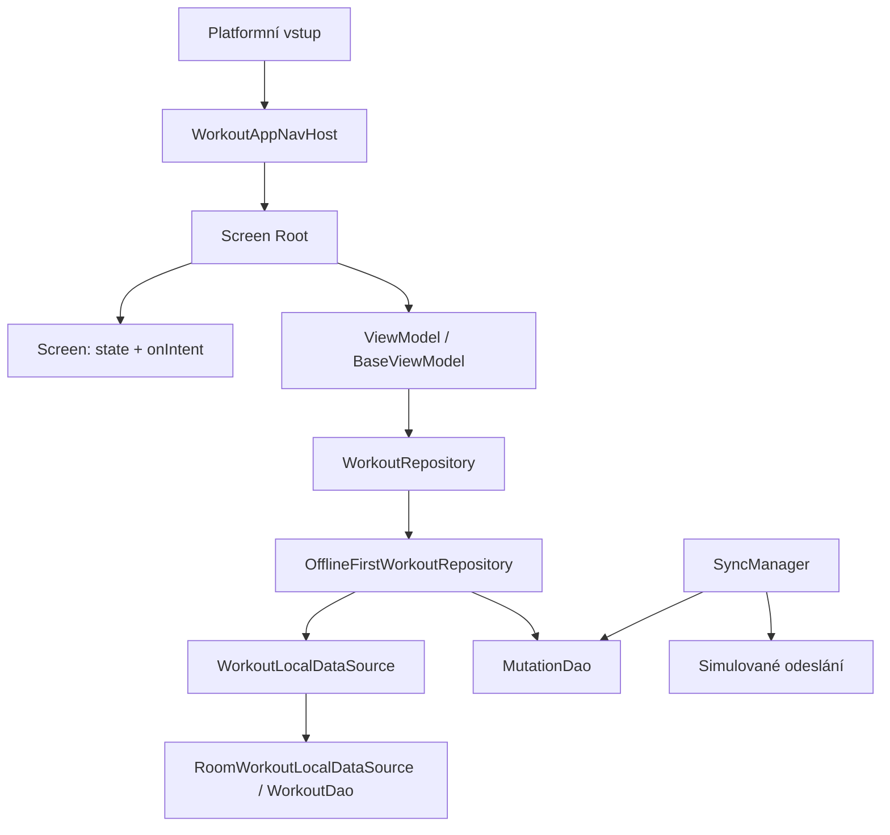

# 🔍 Posouzení architektury ContentApp

> 🗃️ **Historický rozbor před refaktoringem.** Níže uvedené nálezy a čísla řádků popisují původní stav. Aktuální řešení najdeš v [architektuře](../architecture.md) a [MVI průvodci](../mvi.md).

📅 Datum: 28. 10. 2026. Účel: posoudit POC jako základ dalších aplikací.
Rozsah: statická analýza Gradle konfigurace, DI, navigace, MVI, repository, lokálního úložiště, synchronizace a vybraných testů. Testy ani platformní buildy nebyly spouštěny. Nálezy souběhu jsou rizika odvozená z implementace, nikoli reprodukované pády.

## 🎯 Závěr

🎯 Projekt je použitelný jako demonstrační workout aplikace. Před použitím jako šablony dalších produktů potřebuje zpřesnit odpovědnosti a záruky. Největší rizika leží v konzistenci zápisů, souběhu a životním cyklu; samotné přidávání vrstev je neodstraní. Tvrzení README o produkční připravenosti a transakčním outboxu současná implementace nepodporuje.

## 🏗️ Současná struktura

🏗️ Jediný Gradle modul `:composeApp` obsahuje aplikaci i všechny vrstvy. Sdílený kód v commonMain používají platformní source sety Android, desktop a iOS.

🏗️ Jde o logické vrstvy v balíčcích. Build neomezuje importy mezi nimi. `core.database.AppDatabase` přímo zná workout entity a DAO; `core.di.Koin` přímo skládá workout repository a ViewModely. Obsah dnešního `core` proto není jako celek nezávislý základ dalších aplikací. Skládání aplikační databáze a DI patří do části vlastněné aplikací.

## ✅ Co zachovat

- ✅ Rozdělení Root / Screen a tok state → UI → intent jsou srozumitelné.
- ✅ Repository rozhraní dovoluje ViewModelům pracovat bez Room DAO.
- ✅ Mapování Entity ↔ Domain zůstává v datové vrstvě.
- ✅ Kalkulátory výpočtů jsou oddělené od obrazovek a mají cílené testy.
- ✅ AppClock a platformní rozhraní umožňují nahrazovat prostředí při testování.
- ✅ Lokální Flow jako zdroj dat pro UI je vhodný základ offline práce.

## 🚨 Zásadní nálezy

### 💾 1. Outbox nemá atomický zápis — vysoká priorita

💾 `OfflineFirstWorkoutRepository.kt:115` nejprve uloží session přes localDataSource a pak zvlášť vloží mutaci přes MutationDao. Stejný vzor používají úpravy a mazání (`:190`, `:273`, `:288`, `:314`). LocalDataSource a MutationDao nemají společně vyjádřenou transakční operaci.

💾 Pokud druhý zápis selže nebo mezi zápisy skončí proces, lokální změna existuje bez položky outboxu. Podobně `RoomWorkoutLocalDataSource.kt:57` maže série a session dvěma kroky; `:107` ukládá šablonu a její cviky dvěma kroky.

💾 Doporučení: dát transakční zápis dat a mutace do jednoho datového modulu se společnou Room transakcí. Repository musí volat operaci s touto zárukou. Ověřit rollback proti skutečné databázi při chybě druhého zápisu.

### 🔀 2. Souběžné aktualizace pracují se starými kopiemi — vysoká priorita

🔀 `ActiveWorkoutViewModel.kt:264–284` pro každý vstup spouští samostatnou korutinu v ApplicationScope a ukládá celou kopii WorkoutSet z UI. Dvě akce mohou vycházet ze stejného snímku: váha 60 → 65 a reps 10 → 12 mohou skončit hodnotou 60/12 nebo 65/10.

🔀 `BaseViewModel.onIntent` pouze deleguje do handleIntent; neřadí asynchronní operace. Ani kontrola aktivní session před vložením (`OfflineFirstWorkoutRepository.kt:115`) sama nezaručuje jedinou aktivní session při souběhu.

🔀 Doporučení: operace podle ID a konkrétní změny, konzistence a pořadí vyřešené u dat. Pouhá serializace ukládání starých celých objektů nestačí. Testovat souběžné editace i opakované spuštění tréninku.

### 💾 3. Smíšený životní cyklus zápisu a UI — vysoká priorita

♻️ ApplicationScope prodlužuje život korutiny přes zánik ViewModelu, nikoli přes ukončení procesu. `ActiveWorkoutViewModel.kt:134`, `:178`, `:288` uvnitř těchto korutin pracuje se stavem ViewModelu. `finishWorkout` a `cancelWorkout` (`:315`, `:327`) dokončují práci v ApplicationScope, ale posílají efekt přes BaseViewModel.sendEffect a viewModelScope, který už může být zrušený.

♻️ Doporučení: UI držet ve screen scope, delší datovou operaci vlastnit v datové/aplikační části a její výsledek pozorovat jako stav. Pro práci po ukončení procesu je potřeba perzistentní úloha a platformní strategie.

### 🔄 4. Synchronizace je simulace — vysoká priorita při převzetí do produktu

🔄 `SyncManager.kt:104` náhodně simuluje úspěch; Koin (`Koin.kt:29`) vytváří SyncManager s tímto výchozím uploaderem. Úspěch smaže mutaci, aniž by existovalo potvrzení skutečného backendu. Spouštění synchronizace navíc vlastní navigační composable (`WorkoutNavigation.kt:39`).

🔄 Současná implementace neověřuje end-to-end synchronizaci, obnovu po ukončení procesu ani řešení konfliktů mezi zařízeními. Po dosažení retry limitu položky zmizí z pending dotazu (`MutationDao.kt:13`), takže nulový pending count neznamená, že všechny změny byly synchronizovány. Limit je zároveň v DAO fixní a v manageru konfigurovatelný.

🔄 Doporučení: simulátor explicitně oddělit do demo konfigurace. Před tvorbou obecného sync základu určit serverový kontrakt, idempotenci, pořadí závislých mutací, retry a obnovu odložených položek.

### ⚠️ 5. Chybový model není dotažený do toku — vysoká priorita

🚦 Projekt má Result, DataError a safeLocalCall, ale WorkoutRepository vrací přímo modely/Unit. Řada zápisů ve ViewModelech nemá zpracování selhání. `ActiveWorkoutRoot.kt:23` a `WorkoutDetailRoot.kt:29` přijmou ShowSnackbar, ale nic nezobrazí.

🚦 Doporučení: zvolit konzistentní kontrakt očekávaných chyb a skutečně jej propojit s UI. Flow potřebuje zvlášť stanovenou strategii chyb čtení. Ověřit zobrazení chyby a možnost opakování.

### 💾 6. Upgrade databáze může smazat lokální data — vysoká priorita pro produkt

🛡️ `AppDatabase.kt:24` má exportSchema=false. Android `PlatformModule.kt:22` a iOS `PlatformModule.kt:31` používají destructive migration fallback. U aplikace s lokálními nesynchronizovanými daty může upgrade bez příslušné migrace odstranit data i outbox.

🛡️ Doporučení: exportovat schéma, definovat migrace a ověřovat zachování dat včetně mutací.

## 🛠️ Návrhové výhrady

- 🛠️ WorkoutRepository sdružuje cvičení, session, série, šablony, statistiky, export i stav syncu. Jeho implementace má 503 řádků a obsahuje i seedovací data a formátování textu (`getLastPerformance`). Rozdělení má sledovat odpovědnosti, například editaci tréninku, šablony a export; není nutné vyrábět use case pro každou jednořádkovou metodu.
- 🛠️ WorkoutLocalDataSource sice schovává Room a mapování, ale mnohé operace pouze přeposílá. Nenese nejdůležitější záruku společného zápisu dat a outboxu. Další interface se vyplatí tehdy, když skrývá složitost nebo vlastní jasný kontrakt.
- 🛠️ WorkoutAppNavHost používá AnimatedContent a jediný remember currentScreen. Nevyjadřuje back stack ani obnovu destinace po rekreaci. rememberScreenViewModel váže ViewModelStore na přítomnost composable. Je potřeba stanovit pravidla návratu, obnovy stavu a vlastnictví ViewModelů pro cílové platformy.
- 🛠️ History ViewModel při LoadHistory zakládá další dlouhodobé odběry, stejně jako Active ViewModel při LoadWorkout. Veřejný opakovaný intent není zajištěný proti duplicitním odběrům. History openExerciseStats také neruší předchozí collector při změně výběru.
- 🛠️ SystemAppClock vytváří při každém čtení novou monotónní značku a přičítá pevnou epochu; nejde o skutečný aktuální čas. Platformní DI injektuje správné hodiny, ale výchozí konstruktor History ViewModelu tento chybný fallback nabízí.

## 🚀 Směr pro základ dalších aplikací

🚀 Začít malým počtem částí podle skutečné znovupoužitelnosti:

| 🧩 Část | Odpovědnost |
| --- | --- |
| 🚀 Aplikace | Platformní vstupy, DI composition root, navigace, konfigurace a složení databáze |
| 🧱 Sdílený základ | Úzce vymezené obecné rozhraní času, výsledků a ověřené platformní adaptéry |
| 🎨 Design systém | Tokeny a opakovaně použitelné UI bez workout modelů |
| 🚀 Workout feature | Vlastní modely, pravidla, prezentace, data a jejich testy |

🚀 Toto je směr odpovědností, nikoli požadavek okamžitě založit Gradle modul pro každý řádek tabulky. Skutečné moduly dávají smysl pro vynucení důležitých závislostí nebo sdílení mezi aplikacemi. Rozlišit také kopírovatelnou startovací šablonu od společné verzované knihovny: mají jiné náklady na aktualizace a kompatibilitu.

🚀 Pořadí: (1) konzistence zápisů a souběhu, (2) chyby, lifecycle a migrace, (3) oddělení demo syncu, (4) oddělení aplikačního složení od obecného základu, (5) ověření návrhu na druhé malé feature nebo aplikaci.

## 🧪 Limity ověření

🔎 Existující repository testy používají FakeWorkoutDao a FakeMutationDao (`WorkoutRepositoryTest.kt:35`). Jsou užitečné pro orchestrace a výpočty, ale nedokazují skutečné SQL transakce, rollback, migrace ani platformní lifecycle. Údaj README o počtu testů a úspěšnosti nebyl v této analýze ověřen spuštěním. Před opravami mají největší hodnotu regresní scénáře pro atomický outbox, souběžné změny, migrace a dokončení operace po opuštění obrazovky.
