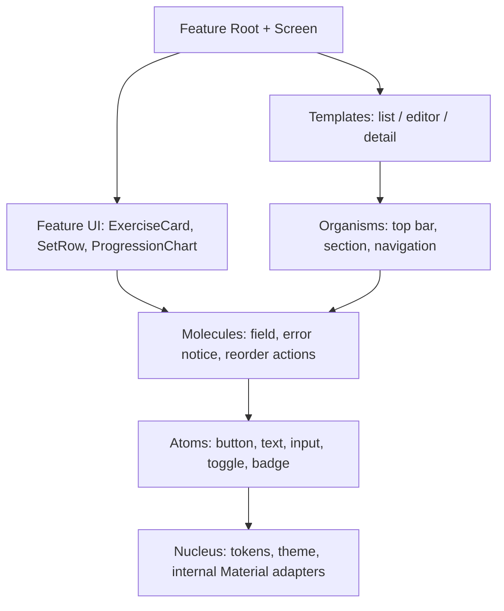

# 🔬 Audit atomic struktury a architektury ContentApp

📅 **29. 10. 2026 · základ `main@fb6078d` · společný audit Codex + GPT-6 Astra.**

**Verdikt: POC má dobrý základ pro lokální konzistenci a modularitu, ale jako hotovou šablonu pro další aplikace bych jej ještě nepřevzal.** Největší rezervy jsou v zapouzdření zapisovacích příkazů, vlastnictví souběžných operací a ve skutečné znovupoužitelnosti design systému. Atomic struktura je pouze částečná. Zelené existující testy tyto mezery nepokrývají.

🔎 Toto je audit celého současného návrhu, nikoli pouze posledního diffu. Codex prošel zejména UI, atomic vrstvy, veřejné kontrakty komponent, duplicity a build hranice. **Astra provedla nezávislou revizi architektury**, datových cest, MVI, DI, navigace a platforem. Její samostatný [report](2026-10-29-astra-architecture-audit.md) doplňuje tento společný závěr. Při orientaci v kódu byl nejprve použit CodeGraph. Produkční kód ani závislosti audit nemění.

## 🧭 Hodnocení oblastí

| Oblast | Stav | Co to znamená pro další aplikaci |
| --- | --- | --- |
| 🧱 Feature `api/impl`, app jako místo sestavení | ✅ Dobrý směr | Zachovat; cizí implementace se mezi feature neimportují. |
| 💾 Room, transakce, outbox, immutable prescription | ✅ Silná část | Zachovat skutečné DB testy, CAS a společný commit. |
| 🔐 Zapouzdření příkazů | 🔴 Nedostatečné | Veřejný kontrakt dovoluje obejít dokončovací workflow; jedna UI akce je jinde rozdělena do dvou commitů. |
| 🔄 MVI a životní cyklus | 🟡 Částečně sjednocené | Dobré oddělení Root/Screen a entry vlastníků; chyby paralelních operací ještě odemykají cizí příkaz. |
| 🎨 Atomic design a veřejné UI rozhraní | 🟡 Nedokončené | Dvě odlišné cesty tvorby UI, směšování vrstev a málo přizpůsobitelné komponenty. |
| ♿ Přístupnost | 🔴 Konkrétní nedostatky | Nevyhovující kontrasty; stav dokončení není vyjádřen sémantikou přepínače. |
| ♻️ Duplicity | 🟡 Odstranitelné na konkrétních místech | Zejména editorový lifecycle/publish algoritmus a opakované UI konstrukce. |
| 🛠️ Toolchain a automatické kontroly | 🟡 Technický dluh | Funkční sestava, ale staré CMP/Room/Nav verze, legacy AGP nastavení a chybějící trvalé kontroly architektury. |
| 🌍 Multiplatformní produktový základ | 🟡 POC rozsah | Android/Desktop základ funguje; iOS kompilace není ověřený iOS produkt. Lokalizace a adaptivní layouty nejsou hotové. |

## 🧪 Co bylo skutečně ověřeno

- 📦 Inventář: **13 aplikačních/library Gradle modulů, 152 produkčních Kotlin souborů**, z toho **9 v design systému**. Nejde o tvrzení, že každý řádek má formální důkaz správnosti.
- ✅ `./gradlew desktopTest testDebugUnitTest :composeApp:assembleDebug :composeApp:compileKotlinIosSimulatorArm64` prošel: **413 úloh, 5 provedeno a 408 up-to-date**. Testovací úlohy využily platné výsledky stejného zdrojového stromu: **198 desktop + 124 Android unit testů**, bez failures/errors/skips. To není nově spuštěných 322 testů.
- 🔬 Astra spustila **čtyři nové cílené runtime probes** proti zkompilovanému produkčnímu kódu. Tři použily skutečnou in-memory Room/Bundled SQLite databázi; čtvrtý skutečný ViewModel s řízeným Flow a odloženým dokončením.
- 🧩 Nový externí konzument pouze `:designsystem` **nekompiluje** při použití veřejného `StatusBadge`. Přidání `:foundation` pouze do tohoto konzumenta kompilaci opraví. Zdrojový projekt přitom zůstal beze změny.
- 🎨 Kontrasty byly vypočteny z konkrétních neprůhledných sRGB tokenů, nikoli odhadnuty ze screenshotu.
- 📚 Doporučení byla porovnána s aktuálními oficiálními zdroji uvedenými u jednotlivých závěrů. Během tohoto auditu neproběhl nový nativní smoke test ani TalkBack/VoiceOver test.

📎 Logy, zdroje probes, inventář a postup reprodukce jsou v [důkazech auditu](evidence/2026-10-29-atomic-architecture/README.md).

## 🔴 Funkční a kontraktové nálezy

### A1 — Dokončení tréninku má dvě veřejné cesty, jedna obchází plán

📍 [WorkoutRepository.kt:37](../../feature/workout/api/src/commonMain/kotlin/features/workout/domain/WorkoutRepository.kt#L37), [OfflineFirstWorkoutRepository.kt:343](../../feature/workout/impl/src/commonMain/kotlin/features/workout/data/OfflineFirstWorkoutRepository.kt#L343), [TrainingWorkflow.kt:28](../../composeApp/src/commonMain/kotlin/app/workflow/TrainingWorkflow.kt#L28), [RoomWorkoutStore.kt:54](../../feature/workout/impl/src/commonMain/kotlin/features/workout/data/RoomWorkoutStore.kt#L54).

**Dopad:** zavolání veřejného `WorkoutRepository.completeWorkout()` dokončí session bez aktualizace plánu. Následný správný `TrainingWorkflow.complete()` už dostane `firstCompletion=false`, takže chybějící posun nedoplní. Probe: plán se sloty A/B, dokončený workout a kurzor stále A, revize nezměněná. Současný ActiveWorkout používá správné workflow; problém je v rozhraní, které může použít další feature. Obě implementace navíc vytvářejí odlišný JSON pro stejný outbox příkaz `COMPLETE`.

🛠️ **Priorita před dalším rozšiřováním:** jeden veřejný příkaz pro dokončení, jehož kontrakt zahrnuje související postup plánu. Nízkou úroveň pro app workflow oddělit od běžného feature rozhraní. Nepřidávat závislost workout impl → plans impl. Regrese musí ověřit všechny aplikační vstupy dokončení a jejich payload. Nízkoúrovňový `WorkoutStore.completeOnce` zůstává transakčním účastníkem workflow a nesmí sloužit jako UI příkaz.

### A2 — Chyba pozorování může odemknout stále běžící příkaz

📍 [ActiveWorkoutViewModel.kt:40](../../feature/workout/impl/src/commonMain/kotlin/features/workout/active/ActiveWorkoutViewModel.kt#L40), [RoutineLibraryViewModel.kt:17](../../feature/routines/impl/src/commonMain/kotlin/features/routines/presentation/RoutineLibraryViewModel.kt#L17), [PlanLibraryViewModel.kt:17](../../feature/trainingplans/impl/src/commonMain/kotlin/features/trainingplans/presentation/PlanLibraryViewModel.kt#L17).

**Dopad:** společný `onOperationFailure` nastaví `isSaving=false`/`busy=false` bez ohledu na původ chyby. Runtime probe: Finish čeká na dokončení, katalogový Flow selže, `isSaving` se vypne a druhý Finish je přijat — **dvě volání completion**. Datová idempotence chrání samotné dokončení, ne celou UI orchestraci a možné opakované navigační efekty. U Library VM je doložený stejný vzor kódu; samostatná runtime reprodukce pro ně nebyla provedena.

🛠️ Oddělit chybu pozorování, chybu příkazu a zámek konkrétní operace. Zámek uvolňuje pouze operace, která jej získala. Editory už tento princip mají v `launchTerminal`; uplatnit jej konzistentně. Regrese: chyba Flow při pending Finish/Cancel/Duplicate nesmí přijmout další terminální akci.

### A3 — Přidání cviku a první série není jeden atomický příkaz

📍 [ActiveWorkoutViewModel.kt:118](../../feature/workout/impl/src/commonMain/kotlin/features/workout/active/ActiveWorkoutViewModel.kt#L118), [OfflineFirstWorkoutRepository.kt:143](../../feature/workout/impl/src/commonMain/kotlin/features/workout/data/OfflineFirstWorkoutRepository.kt#L143).

**Dopad:** `addExerciseEntry()` a `addSetToEntry()` jsou dva samostatné commity. Probe s chybou druhého outbox insertu ponechá **1 cvik, 0 sérií**. Podobná mezera existuje při zániku caller scope mezi příkazy. To neporušuje atomickost jednotlivých metod; nesplňuje to atomickost celé uživatelovy akce.

🛠️ Vytvořit jeden datový příkaz `addExerciseWithInitialSet`, který přijme potřebné hodnoty a v jedné vnější transakci uloží entry, sérii a oba outbox záznamy. ViewModel volá pouze tento příkaz. Ověřit rollback druhého insertu a zrušení volajícího po přijetí příkazu.

### A4 — „Předchozí výkon“ se vybírá podle UUID, ne podle času

📍 [WorkoutDao.kt:60](../../feature/workout/impl/src/commonMain/kotlin/features/workout/data/dao/WorkoutDao.kt#L60), [RoomWorkoutStore.kt:35](../../feature/workout/impl/src/commonMain/kotlin/features/workout/data/RoomWorkoutStore.kt#L35).

**Dopad:** `ORDER BY id DESC` nemá u náhodných UUID časový význam. Nové a staré ID formáty se navíc liší prefixem. Room probe se dvěma dokončenými session vrátil starší výkon s časem dokončení 200 místo novějšího 400, protože `zz-old` se řadí za `aa-new`.

🛠️ Vyjádřit politiku „předchozí“ doménově a seřadit query podle skutečného času session/výkonu s deterministickým tie-breakerem. Pro předchozí dokončený trénink filtrovat dokončené session; případné zahrnutí aktuální session musí být výslovná volba. Přidat testy s UUID opačného pořadí a opakovanými instancemi stejného cviku.

### A5 — Veřejné UI rozhraní skrývá potřebnou závislost

📍 [designsystem/build.gradle.kts:18](../../designsystem/build.gradle.kts#L18), [StatusBadge.kt:27](../../designsystem/src/commonMain/kotlin/ui/designsystem/atoms/feedback/StatusBadge.kt#L27).

**Dopad:** `StatusBadge(status: ItemSyncStatus)` vystavuje typ z foundation, ale dependency je `implementation`. Nová aplikace s jedinou závislostí na design systému tento typ na compile classpath nemá. Izolovaný konzument skončil na `Unresolved reference ItemSyncStatus`; kontrolní běh s explicitní foundation prošel.

🛠️ Buď foundation exportovat přes `api`, nebo lépe z hlediska nezávislosti komponenty zavést vlastní prezentační stav odznaku a mapování u volajícího. Pouhé přidávání skryté dependency do každé budoucí aplikace problém rozhraní neřeší. Rozlišení veřejných a interních závislostí odpovídá [Gradle API/implementation pravidlům](https://docs.gradle.org/current/userguide/java_library_plugin.html#sec:java_library_separation).

## 🧱 Atomic struktura, zapouzdření a duplicity

### A6 — Atomic vrstvy dnes nejsou skutečně sjednocené

📍 [LibraryComponents.kt:13](../../designsystem/src/commonMain/kotlin/ui/designsystem/nucleus/LibraryComponents.kt#L13), [UniversalScreenTemplate.kt:27](../../designsystem/src/commonMain/kotlin/ui/designsystem/templates/UniversalScreenTemplate.kt#L27), [ExerciseCard.kt:50](../../feature/workout/impl/src/commonMain/kotlin/features/workout/ui/components/ExerciseCard.kt#L50), [WorkoutDetailScreen.kt:295](../../feature/workout/impl/src/commonMain/kotlin/features/workout/detail/WorkoutDetailScreen.kt#L295).

**Zjištění:** `nucleus/LibraryComponents.kt` obsahuje text, tlačítko, input, kartu, picker, dialog, stránku i navigaci. Atomy mají pouze dva feedback soubory; organisms nejsou vyčleněné. **21 souborů importuje Material3 mimo nucleus**, z toho 18 ve workout a 3 přímo v design systému. Jde o inventář importujících souborů, ne o počet zakázaných konstruktorů. Dokumentace legacy výjimku výslovně přiznává; audit ji hodnotí jako dluh před dalším použitím POC.

**Dopad:** chybí jedno místo pro styl tlačítek, karet, typografii a interakční pravidla. `ExerciseCard`, `DetailExerciseCard` a `WeeklyStreakCard` opakují stejnou skladbu clip/background/border/padding. Oprava společného `AppCard` je neovlivní. Dvě page implementace zvlášť řeší insets a IME.

🛠️ Zachovat jeden Gradle modul `designsystem`, uvnitř ale skutečně rozdělit zodpovědnosti. Material konstrukce mohou být interní adaptéry v nucleus; veřejné atomy přidají sémantiku a vlastní stabilní kontrakt. Směr importů musí být kontrolovaný. Všech šest vrstev nemusí mít vlastní Gradle modul ani povinnou prázdnou obálku.

🎯 Fitness komponenty zůstávají u workout. Do společné vrstvy patří jejich obecné stavební prvky. Pro tento projekt doporučuji dotáhnout zvolenou Material fasádu; používání Material komponent samo o sobě není proti oficiálním best practices. Google připouští rozšíření MaterialTheme i vlastní design systém. [Oficiální možnosti design systémů](https://developer.android.com/develop/ui/compose/designsystems/custom).

### A7 — Společné komponenty mají příliš úzké rozhraní

📍 [LibraryComponents.kt:13](../../designsystem/src/commonMain/kotlin/ui/designsystem/nucleus/LibraryComponents.kt#L13), [EditorNotices.kt:6](../../designsystem/src/commonMain/kotlin/ui/designsystem/molecules/EditorNotices.kt#L6).

`AppText`, `AppAction`, `AppInput`, `AppCard`, `AppChoice`, `AppConfirm`, `AppPage`, `AppTabs` a `AppLoading` nemají `Modifier`. Volající proto nemůže přímo nastavit test tag, sémantiku, fokus ani potřebné rozložení. `AppInput` navíc nezpřístupňuje keyboard options, error/supporting text, single/multiline režim. Číselné vstupy editoru tak používají stejné rozhraní jako poznámka. `AppConfirm` má napevno editorovou větu „Pokračovat v úpravách“, ačkoliv jde o obecně pojmenovaný dialog; tab ikona je pouze `String`.

🛠️ Doplnit `Modifier`, cílené parametry a sloty podle skutečných potřeb. Rozlišit sémanticky primární/sekundární/destruktivní akci. Obecný dialog musí dostat popisky nebo obsah od volajícího; editorová varianta může být samostatná složená komponenta. Cílem není vystavit všechna Material nastavení nebo vytvořit jeden univerzální component s desítkami přepínačů. [Compose component API guidelines](https://android.googlesource.com/platform/frameworks/support/+/androidx-main/compose/docs/compose-component-api-guidelines.md) doporučují Modifier na kořenovém layoutu a kompozici přes sloty.

### A8 — Přístupnost není dotažená do sdílených pravidel

📍 [AppColors.kt:37](../../designsystem/src/commonMain/kotlin/ui/designsystem/nucleus/AppColors.kt#L37), [StatusBadge.kt:32](../../designsystem/src/commonMain/kotlin/ui/designsystem/atoms/feedback/StatusBadge.kt#L32), [SetRowItem.kt:135](../../feature/workout/impl/src/commonMain/kotlin/features/workout/ui/components/SetRowItem.kt#L135), [SetRowItem.kt:223](../../feature/workout/impl/src/commonMain/kotlin/features/workout/ui/components/SetRowItem.kt#L223).

| Skutečná kombinace ve světlém tématu | Kontrast |
| --- | ---: |
| Pending text `D97706` / container `FEF3C7` | **2,861 : 1** |
| Synced text `16A34A` / container `DCFCE7` | **3,001 : 1** |
| Error text `DC2626` / container `FEE2E2` | **3,953 : 1** |
| Primary `0284C7` / bílá | **4,095 : 1** |
| onSurfaceVariant `64748B` / surfaceVariant `F1F5F9` | **4,344 : 1** |

První tři kombinace používá malý text ve `StatusBadge` a nesplňují 4,5 : 1. Komentář u Primary o „4.6 : 1“ je chybný; konkrétní požadavek u jiných prvků závisí i na velikosti textu. WCAG pro běžný text uvádí 4,5 : 1, pro velký 3 : 1. [Kontrast podle W3C](https://www.w3.org/WAI/WCAG22/Understanding/contrast-minimum.html).

Zaškrtávání série používá `Role.Button` a stále stejný znak ✓; dokončení mění barvu, ale komponenta neposkytuje checked/state sémantiku. Vstupy váhy/opakování mají pevné boxy vysoké 38 dp. To je konkrétní důvod otestovat 2× font a cíle interakce; samotný rozměr boxu zde nevydáváme za změřený nativní touch target. `ExerciseCard` má akce jen s 📈/✕ bez názvu jejich účelu.

🛠️ Opravit tokeny, přidat kontrastní regresi, použít toggle/checkbox sémantiku a smysluplné názvy akcí. Zachovat požadované emoji jako vizuální doplněk. Přidat testy 320 dp + fontScale 2,0, světlé/tmavé téma a nativní čtečku. [Compose accessibility defaults](https://developer.android.com/develop/ui/compose/accessibility/api-defaults).

### A9 — Editorový algoritmus je zkopírovaný mezi feature

📍 [RoutineEditorViewModel.kt:19](../../feature/routines/impl/src/commonMain/kotlin/features/routines/presentation/RoutineEditorViewModel.kt#L19), [PlanEditorViewModel.kt:19](../../feature/trainingplans/impl/src/commonMain/kotlin/features/trainingplans/presentation/PlanEditorViewModel.kt#L19).

Oba soubory mají 144 řádků; 114 řádků je přesně shodných včetně importů/prázdných řádků. Důležitější než poměr je **stejný algoritmus**: lease → raw autosave → barrier → terminal lock → publikace v transakci → odstranění draftu → efekt. ViewModely zároveň znají `DraftStore`, `CommandCoordinator` i storage kind. Kopie existují i pro `moved`/`RowActions` v obou editorech a pro obsluhu Library VM.

🛠️ Vytáhnout společné řízení editorové session a terminálních operací do malého controlleru, použitého kompozicí. Doménové drafty, validace, repository a konkrétní choices zůstanou ve feature. Publikační use case má skrýt transakční pořadí před ViewModelem. Stávající regresní testy musí po extrakci dál ověřovat obě feature. Nevytvářet generický superclass pro všechny obrazovky; podobnost routiny a plánu neznamená stejná business pravidla.

### A10 — Vlastnictví katalogu a neutralita společného základu jsou jen částečné

📍 [ExerciseCatalog.kt:5](../../feature/exercises/api/src/commonMain/kotlin/features/exercises/api/ExerciseCatalog.kt#L5), [RoomExerciseCatalog.kt:29](../../feature/exercises/impl/src/commonMain/kotlin/features/exercises/data/RoomExerciseCatalog.kt#L29), [WorkoutRepository.kt:14](../../feature/workout/api/src/commonMain/kotlin/features/workout/domain/WorkoutRepository.kt#L14), [UiText.kt:23](../../foundation/src/commonMain/kotlin/core/ui/UiText.kt#L23), [AppTheme.kt:51](../../designsystem/src/commonMain/kotlin/ui/designsystem/nucleus/AppTheme.kt#L51).

Katalog je oddělený modulem, ale vytvoření/seed a související outbox stále vlastní workout. Veřejné `saveExercise`/`saveExercises` outbox nevytvářejí a dokumentují odpovědnost volajícího; `archive` jej naopak vytváří. Budoucí editor katalogu se musí naučit interní protokol ukládání. To je špatně zapouzdřený kontrakt, ne tvrzení, že dnešní create cesta nemá outbox.

Foundation navíc obsahuje fitness chyby `INVALID_WEIGHT`/`INVALID_REPS` a jejich české texty; design systém veřejné tokeny `prGold`. Jde o menší, ale konkrétní produktovou vazbu při kopírování do nefitness aplikace.

🛠️ Katalog má vlastnit své veřejné create/update/archive příkazy i atomický outbox. Oddělit interní import/seed cestu. Doménové validační chyby ponechat ve feature; textové zdroje a lokalizaci v presentation. Obecný success/warning/accent token patří do design systému, význam „osobní rekord“ do workout UI.

## 🚀 Moderní best practices a připravenost na další aplikace

### A11 — Toolchain funguje, ale není současným výchozím bodem

📍 [libs.versions.toml:9](../../gradle/libs.versions.toml#L9), [gradle.properties:20](../../gradle.properties#L20), [composeApp/build.gradle.kts:1](../../composeApp/build.gradle.kts#L1).

Projekt má CMP **1.7.0**, Navigation **2.8.0-alpha10**, Room **2.7.0-alpha11**, SQLite **2.5.0-alpha11** a AGP **9.3.1** s `android.builtInKotlin=false`/`android.newDsl=false`. Ke dni auditu oficiální zdroje uvádějí stabilní CMP **1.12.2** a Room **2.8.5**. [CMP release](https://github.com/JetBrains/compose-multiplatform/releases/tag/v1.12.2), [Room releases](https://developer.android.com/jetpack/androidx/releases/room).

🛠️ Připravit jednu kompatibilní cílovou sestavu Kotlin/CMP/Koin/Room/SQLite/Navigation/AGP a migrovat odděleně od změn business logiky. Novější jednotlivá dependency není důkaz kompatibility celku. Ověřit Android, desktop, iOS a všechny migrace; teprve potom odstranit potřebné compatibility workarounds. [JetBrains compatibility guide](https://kotlinlang.org/docs/multiplatform/compose-compatibility-and-versioning.html).

### A12 — Pravidla architektury se převážně kontrolují ručně

📍 [settings.gradle.kts](../../settings.gradle.kts), [feature/routines/impl/build.gradle.kts:9](../../feature/routines/impl/build.gradle.kts#L9), [feature/trainingplans/impl/build.gradle.kts:9](../../feature/trainingplans/impl/build.gradle.kts#L9).

V repozitáři nebyla nalezena verzovaná CI konfigurace ani automatická kontrola směru atomic importů a feature závislostí. Současný graf je dobře oddělený, ale přidání cizího `impl` do budoucího Gradle souboru ničemu automaticky neodporuje. Opakuje se target/SDK/plugin konfigurace napříč 13 moduly. `designsystem` nemá vlastní test sources; má pouze společný preview několika prvků, nikoli komponentovou coverage matrix.

🛠️ Přidat CI gate pro existující sady + architektonické kontroly a consumer compilation. Sdílet build nastavení přes malé convention plugins. Vynutit povolený graf, Material import policy a absenci platformních importů v commonMain. CI doplnit kontrast/semantics/layout testy komponent a skutečný iOS host smoke, pokud má být iOS podporovaný produkt.

### A13 — Síťový stub má nevhodný výchozí logging

📍 [HttpClientFactory.kt:22](../../composeApp/src/commonMain/kotlin/core/network/HttpClientFactory.kt#L22).

Factory instaluje `LogLevel.ALL` a předává celý obsah do Napier bez redakce. Není aktuálně zapojeným uploaderem: **audit neprokázal probíhající únik dat**. Je to nevhodný vzor, který by se snadno přenesl do další aplikace při zapnutí sítě.

🛠️ Před použitím sítě nastavit bezpečný production default, vynechat body a citlivé hlavičky, záměrný debug režim řešit zvlášť. Samotné maskování Authorization nezaručuje bezpečnost těl požadavků. Podrobnosti a oficiální Ktor zdroj jsou v [Astra reportu](2026-10-29-astra-architecture-audit.md).

### 🧭 Další rozhodnutí podle produktu

| Téma | Závěr auditu |
| --- | --- |
| 🔄 StateFlow, repository, constructor DI | Současný směr odpovídá UDF a oddělení UI/dat. Přímé Room entity nejsou business API modely. |
| ⚡ Channel effects | Vědomý kompromis, nikoli durable event queue. Kritický výsledek musí být odvoditelný z DB/stavu po rekreaci. Moderní Android doporučení preferuje převod ViewModel událostí do stavu. |
| ♻️ Odběr stavu | Nové Roots používají lifecycle-aware collection, workout Roots stále `collectAsState`. Sjednotit; samotné zastavení UI collectoru ale nezastaví eagerly běžící práci ve ViewModelu. |
| 🧭 Navigation | Typované routes a entry ownership zachovat. Současné Android doporučení preferuje Navigation 3; přechod pro KMP ověřit jako samostatnou migraci, ne podmínku správnosti dnešního workflow. |
| 🌍 Lokalizace | České řetězce v komponentách, foundation a doménových displayName nejsou hotový lokalizovatelný základ. Před druhým jazykem zavést resource resolver. |
| 🖥️ Adaptivita | `AppNavHost` vždy kreslí spodní bar; `AppPage` vždy jednu LazyColumn bez parametrů pro šířku/stav. Pro tablet/desktop navrhnout šířkové varianty, případně list-detail a rail. |
| 📚 Větší obsah | Dnešní celé seznamy/aggregate flows vyhovují malému POC. Pro velký katalog/historii měřit, zavést lehké list projections, query filtry a stránkování podle objemu dat. |
| ☁️ Sync, auth, vzdálený obsah | Backend sync je výslovně nedokončený. Outbox je dobrý základ, ale neprokazuje offline sync produkt: budou potřeba serverová idempotence, konflikty, retry/restart a případně izolace uživatelů. |

První čtyři řádky porovnávají projekt s [aktuálními doporučeními Android architektury](https://developer.android.com/topic/architecture/recommendations); nejde o požadavek přenést Android-only technologie, například Hilt, do KMP. Volba rail/bar vychází z [adaptive navigation guidance](https://developer.android.com/develop/ui/compose/layouts/adaptive/build-adaptive-navigation). Šest atomic vrstev je místní návrhová konvence, nikoli univerzální požadavek Googlu.

## 🛠️ Doporučené pořadí úprav

| Etapa | Konkrétní změna | Podmínka dokončení |
| --- | --- | --- |
| 1 · 🔐 Opravit funkční kontrakty | A1–A4: jedna completion cesta, vlastníci zámků, atomické přidání, správná chronologie | Čtyři dnešní repro scénáře přejdou do trvalých regresních testů s očekávaným správným výsledkem. |
| 2 · 🎨 Dotáhnout společné UI | A5–A8: veřejné dependencies, vrstvy, Modifier/sloty, tokeny a sémantika | Izolovaný consumer kompiluje; workout i editory používají společné prvky; kontrast a malé/velké layouty projdou. |
| 3 · ♻️ Odstranit opakovanou orchestraci | A9–A10: editor controller, publikační use cases, vlastnictví katalogu | Jedna implementace lease/publish lifecycle, domény zůstanou oddělené; rollback a cancellation regrese zachovány. |
| 4 · 🛠️ Připravit šablonu k používání | A11–A13: kompatibilní toolchain, convention plugins, CI, bezpečný network default | Reprodukovatelné kontroly na podporovaných platformách; porušení pravidel zastaví automatická kontrola. |

✅ Zachovat single local source of truth, atomický data/outbox commit, CAS, immutable prescription, app-owned workflow a testy skutečné DB. Tyto části mají praktickou hodnotu. **Před kopírováním POC do další aplikace bych dokončil zejména první dvě etapy.**
