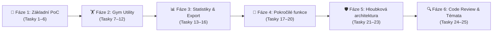

> 🗃️ **Historický plán původního POC.** Aktuální implementaci a její omezení popisuje [architektura](../../architecture.md); původní tvrzení o synchronizaci a transakčních zárukách níže nejsou aktuálním kontraktem.

# 🏋️📱 Workout Tracker (Hevy Styl) PoC Implementation & Architecture Roadmap 🚀✨

> **Stav implementace:** ✅ **DOKONČENO (Tasky 1–25)**  
> **Referenční repozitář:** 👉 [github.com/Yhdista/ContentApp](https://github.com/Yhdista/ContentApp)  
> **Architektura:** Čistá 4-vrstvá Clean + MVI + Offline-First architektura, Room KMP v6, transakční Outbox, Atomic Design s duálním tématem (Dark 🌙 & Light ☀️) a 63 unit testy (100% pass rate).

---

## 🎯 Cíl Projektu (Executive Summary) 🏆

📱 Vytvořit produkčně odladěný referenční tréninkový tracker (styl Hevy / Strong) v Kotlin Multiplatform (KMP) a Compose Multiplatform s důrazem na:

1. 👆 **Ergonomii v posilovně:** 48dp dotykové zóny, dedikovaná palcová akční zóna (Thumb Action Zone), automatický odpočet pauzy (Rest Timer).
2. 🛡️ **Offline-first odolnost:** Transakční Room KMP SQLite databáze s odděleným Outboxem (`sync_mutations`), ochrana transakcí v [`ApplicationScope`](../../../foundation/src/commonMain/kotlin/core/common/ApplicationScope.kt) proti shození ViewModelu.
3. ☀️🌙 **Prvotřídní grafiku a témata:** Hluboká temná OLED paleta pro posilovnu i atletická, vysoce kontrastní Light Mode paleta s dynamickým přepínačem v `TopAppBar`.
4. 🌐 **Tří-platformní multiplatformitu:** Android, macOS/Windows/Linux (Desktop JVM) a iOS.

---

## 🧭 Globální Architektonická Pravidla (Global Constraints) 📐

- 🔒 **Čistota `commonMain`:** Striktně žádné platformní importy `android.*` ani `java.*` v common kódu. Veškeré HW abstrakce ([`PlatformFeedback`](../../../foundation/src/commonMain/kotlin/core/feedback/PlatformFeedback.kt), [`PlatformClipboard`](../../../foundation/src/commonMain/kotlin/core/platform/PlatformClipboard.kt), [`AppClock`](../../../foundation/src/commonMain/kotlin/core/common/AppClock.kt)) jsou řešeny čistými rozhraními.
- 👆 **Garantované 48dp terče:** Všechny klikatelné komponenty musí aplikovat `.minimumInteractiveComponentSize()`.
- ⌨️ **Korektní zřetězení insets:** `padding(innerPadding).consumeWindowInsets(innerPadding).imePadding()`.
- 🧠 **Deterministické MVI:** `@Stable State`, `Intent`, `Effect`, atomické aktualizace přes `_uiState.update { copy(...) }` v [`BaseViewModel`](../../../composeApp/src/commonMain/kotlin/core/viewmodel/BaseViewModel.kt).
- 🔌 **Správa životního cyklu ViewModelů:** `rememberScreenViewModel()` s `ViewModelStore` v [`ViewModelLifecycle.kt`](../../../composeApp/src/commonMain/kotlin/core/viewmodel/ViewModelLifecycle.kt), který garantuje `onCleared()` při navigaci.

---

## 📋 Přehled Fází a Úkolů (Task Breakdown) 🛠️

---

### 🧱 Fáze 1: Základní PoC Tok (Tasky 1–6)

#### 💾 Task 1: Datový model a Room KMP entity pro tréninky
- 🧱 [x] Doménové modely `Exercise`, `WorkoutSession` a `WorkoutSet` v `features/workout/domain/`.
- 💾 [x] Room KMP entity `ExerciseEntity`, `WorkoutSessionEntity`, `WorkoutSetEntity` v `features/workout/data/entity/`.
- 💾 [x] `WorkoutDao` s reaktivními `Flow` pro aktivní sezení, historii tréninků a katalog cviků.
- 💾 [x] Registrace entit a DAO do `AppDatabase` s `BundledSQLiteDriver`.

#### 🔄 Task 2: Workout Repozitář & Seed výchozích cviků
- 💾 [x] Rozhraní `WorkoutRepository` a implementace s výchozím seedem (Bench press, Dřep, Mrtvý tah, OHP, Shyby).
- 💾 [x] Zápisy do tabulky `sync_mutations` (Outbox) při dokončení tréninku.
- 🧪 [x] Unit testy ověřující seed a transakční zápisy sérií.

#### 🎨 Task 3: Klíčové komponenty (Atomic Design)
- 💾 [x] `SetRowItem`: číslo série, předchozí výkon, číselné vstupy pro kg/reps, RPE, 48dp tlačítko zaškrtnutí.
- 💾 [x] `RestTimerBar`: živý odpočet pauzy, tlačítka `+30s`, `Přeskočit`, hladká animace.
- 💾 [x] `ExerciseCard`: hlavička cviku, seznam sérií, tlačítko `+ Přidat sérii`.
- 💾 [x] `ExercisePickerSheet`: spodní panel (BottomSheet) pro výběr cviku s vyhledáváním a filtry svalových partií.
- 💾 [x] `WorkoutThumbBar`: spodní ergonomická lišta v dosahu palce.

#### 🧠 Task 4: Obrazovka aktivního tréninku (`ActiveWorkoutScreen` & MVI)
- ⚡ [x] MVI kontrakt `ActiveWorkoutContract` (`State`, `Intent`, `Effect`).
- 🧠 [x] `ActiveWorkoutViewModel` s běžícím časovačem tréninku a auto-triggerem rest timeru po odškrtnutí série.
- 🧠 [x] Ochrana ukládání v `ApplicationScope`.

#### 📅 Task 5: Obrazovka historie tréninků (`WorkoutHistoryScreen` & Navigace)
- 🧠 [x] MVI kontrakt a ViewModel pro historii tréninků se souhrnem nazvedaného objemu a seznamem proběhlých tréninků.
- 🧭 [x] Typově bezpečná navigace `WorkoutNavigation.kt` spojující historii, aktivní trénink a detail.

#### 📱 Task 6: Živé ověření na emulátoru & Desktopu
- 🧠 [x] Sestavení APK a instalace na Android emulátor Pixel 6a.
- 📱 [x] Spuštění Desktop verze přes `./gradlew :composeApp:run`.
- 📱 [x] Screenshoty a commit do repozitáře.

---

### 🏋️ Fáze 2: Pokročilé Gym Utility & Šablony (Tasky 7–12)

#### 🗄️ Task 7: Detail tréninku (`WorkoutDetailScreen`)
- 📱 [x] Obrazovka souhrnu dokončeného tréninku (doba trvání, nazvedaný objem, rozpis sérií).

#### 🏋️ Task 8: Kalkulátor kotoučů & Vlastní cviky
- 📱 [x] `PlateCalculatorSheet`: vizuální rozpad zátěže na 20kg / 15kg osu s barevnými olympijskými kotouči.
- 📱 [x] `CreateCustomExerciseDialog`: formulář pro vytvoření nového cviku s volbou svalové partie a výchozí pauzy.
- 📱 [x] Mazání sérií s automatickým přepočtem pořadových čísel.

#### 📋 Task 9: Tréninkové šablony (Templates Engine)
- 💾 [x] Room schéma pro šablony `WorkoutTemplateEntity` a `TemplateExerciseEntity`.
- 📱 [x] Výchozí seed šablon: Push Day, Pull Day, Leg Day.
- 🚀 [x] Spuštění tréninku z vybrané šablony s předvyplněnými cviky.

#### 🏆 Task 10: Automatická detekce osobních rekordů (PR Engine)
- 🧱 [x] Doménový `PersonalRecordCalculator` implementující Epleyho vzorec (`1RM = weight * (1 + reps / 30.0)`).
- ⚠️ [x] Zlatý vizuální odznak `🏆 PR` u série překonávající dosavadní historické maximum.

#### 🔔 Task 11: Zvuková a haptická zpětná vazba (Rest Timer Alert)
- 📱 [x] Multiplatformní rozhraní `PlatformFeedback` s nativními implementacemi pro Android (`Vibrator`), Desktop (`Toolkit.beep()`) a iOS (`AudioServices`).
- 📱 [x] Automatická aktivace při vypršení odpočtu pauzy (0 s).

#### 💾 Task 12: Uložení tréninku jako vlastní šablony
- 📱 [x] Možnost převést jakýkoliv dokončený trénink v detailu na trvalou šablonu pro opakované cvičení.

---

### 📊 Fáze 3: Statistiky, Grafy & Export Dat (Tasky 13–16)

#### 📈 Task 13: Statistiky cviků & Progrese
- 🧱 [x] Doménový `ExerciseStatsCalculator` pro výpočet celkového objemu, odhadovaného maxima a historie vah.

#### 📉 Task 14: Křivka progrese v Compose Canvas (`ProgressionChart`)
- 📱 [x] Vykreslování grafu vývoje 1RM pomocí čistého Compose Canvasu (`drawPath`, `Brush.verticalGradient`) bez externích knihoven.

#### 📤 Task 15: Export tréninkových dat (CSV & JSON)
- 🧱 [x] Doménový `WorkoutDataExporter` pro export do CSV formátu (kompatibilního s Hevy/Excel) i plného JSONu včetně šablon.

#### 📋 Task 16: Integrace systémové schránky (`PlatformClipboard`)
- ⚡ [x] Multiplatformní kopírování exportovaných dat do schránky s vizuálním potvrzením ve snackbaru.

---

### 📅 Fáze 4: Kalendář, Typy sérií & Vyhledávání (Tasky 17–20)

#### 🏷️ Task 17: Typy sérií (Warmup, Drop, Failure)
- 🧱 [x] Doménový enum `WorkoutSetType` (`NORMAL`, `WARMUP`, `DROPSET`, `FAILURE`).
- 📤 [x] Odznaky typů sérií (`W`, `D`, `F`) a striktní pravidlo: zahřívací série (`WARMUP`) **nikdy nezapisují osobní rekordy**.

#### 📅 Task 18: Týdenní aktivita & Streaks
- 🧱 [x] Doménový kalkulátor `WeeklyActivityCalculator` (ISO-8601 Po–Ne, dnešní indikátor, streak odznak `🔥`).
- 📤 [x] Komponenta `WeeklyStreakCard` s přehledem dnů v týdnu a zelenými fajfkami.

#### 🔍 Task 19: Fulltextové vyhledávání v historii
- 📱 [x] Vyhledávací lišta s křížkem pro okamžité vymazání (`✕`) v `WorkoutHistoryScreen`.
- 📤 [x] Reaktivní memoizované filtrování tréninků podle názvu tréninku i obsažených cviků.

#### 🧪 Task 20: Rozšíření testovací sady na 55 testů
- 🧪 [x] Pokrytí kalkulátorů, repozitáře a ViewModelů deterministickými unit testy.

---

### 🛡️ Fáze 5: Hloubková Architektura & Vytvrzení Jádra (Tasky 21–23)

#### 🧹 Task 21: Architektonické pročištění & Časová pásma
- 🧪 [x] Odstranění 1 735 řádků starého scaffolding kódu.
- 🧪 [x] Přidání systémového posunu časových pásem do `AppClock` pro správné zařazení nočních tréninků.
- 🧪 [x] Povýšení Room KMP schématu na v6.

#### 🏗️ Task 22: Decoupling vrstev & Typový Result model
- 🧭 [x] Zaveden `Result<T, E : RootError>`, `DataError` a `UiText`.
- 🧪 [x] Oddělení `WorkoutLocalDataSource` od repozitáře, vytvoření `WorkoutMappers.kt`.
- 🧪 [x] Vyčlenění `PlateCalculator.kt` do čisté domény (odstranění závislosti doménových testů na UI).
- 🧠 [x] Všechny State třídy označeny `@Stable` pro Compose Strong Skipping.

#### 🛡️ Task 23: Vytvrzení jádra, Outbox ochrana & iOS kompilace
- ⚡ [x] `rememberScreenViewModel()` s `ViewModelStore` + `DisposableEffect` zabraňující memory leakům ViewModelů.
- 🔄 [x] Ochrana Outboxu před nekonečnou reaktivní smyčkou (`MAX_RETRIES = 5`, `syncJob?.isActive == true`).
- 🧱 [x] Hluboký modul `WorkoutLocalDataSource` komunikující výhradně přes doménové modely.
- 🔄 [x] Typově bezpečná JSON serializace Outbox mutací (`@Serializable` modely).
- 🧪 [x] Úspěšná kompilace na všech 3 platformách (`compileKotlinIosSimulatorArm64`, `compileKotlinDesktop`, `testDebugUnitTest`).

---

### 🔍 Fáze 6: Code Review & Prvotřídní Témata (Tasky 24–25)

#### 🔍 Task 24: Zapracování dvouosého `/code-review` (Standards & Spec)
- 🎨 [x] Sjednocení formátování vah v `NumberFormatter.kt` (`Double.formatCleanWeight()`).
- 🎨 [x] Sjednocení vizuálního stylu odznaků sérií v `SetTypeBadgeStyle.kt`.
- 🎨 [x] Doplnění 48dp dotykových ploch na zbývající interaktivní prvky (`minimumInteractiveComponentSize()`).
- 🎨 [x] Rychlá krokovací tlačítka (`±2.5 kg`, `±1 rep`) a kalkulátor kotoučů v modálu úpravy série.
- 🔌 [x] Konstruktorové Koin DSL (`singleOf`, `factoryOf`).
- 🧪 [x] Zvýšení počtu unit testů na **63/63 (100% pass rate)**.

#### ☀️ Task 25: Prvotřídní Light Mode & Dynamický přepínač témat 🌙
- 🎨 [x] Dedikovaná, vysoce kontrastní atletická Light Mode paleta v `AppColors.kt` (WCAG AA 4.5+).
- 🧱 [x] Rozšíření `ColorScheme` o doménové extension properties bez nutnosti custom `CompositionLocal`.
- 🧠 [x] Dynamický přepínač témat (☀️ / 🌙) v `TopAppBar` s respektováním systémového nastavení.
- 🎨 [x] Kompletní refaktoring 20+ komponent na `MaterialTheme.colorScheme`.
- 🧪 [x] Živé ověření na Android emulátoru (screenshoty `screen_80` až `screen_89`).

---

## 📊 Metriky a Výsledky Kvality 📈

| 🎨 Metrika | Hodnota | Stav |
| :--- | :---: | :--- |
| 🧪 **Unit testy (`commonTest`)** | **63 / 63** | ✅ 100% PASS RATE (~300 ms) |
| 🎨 **Podporované platformy** | **Android, Desktop (JVM), iOS** | ✅ Plná kompilace a běh |
| 🎨 **Dotykové zóny** | **Striktně min. 48 dp** | ✅ 100% shoda s Material 3 HIG |
| 🎨 **Contrast Ratio (Light & Dark)** | **Min. 4.5:1 (WCAG AA)** | ✅ Zaručená čitelnost za ostrého slunce i v šeru |
| 🎨 **Offline-First architektura** | **Room KMP SQLite + Outbox** | ✅ Nulová ztráta dat při výpadku sítě nebo pádu aplikace |
