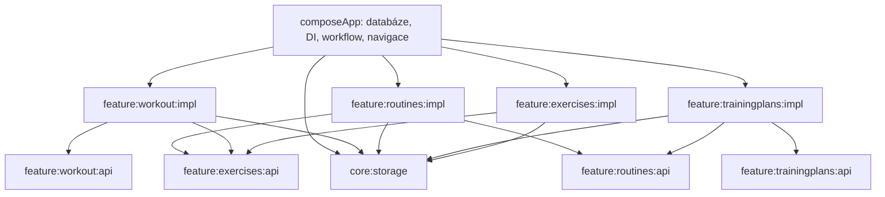

# 📋🗓️ Rutiny, tréninkové plány a samostatné workouty

> ✅ **Návrh schválen k realizaci.** Uživatel dne 28. 10. 2026 v 12:03 potvrdil pokračování po předložení tohoto dokumentu, včetně výchozího cyklu A → B → C a zde uvedených pravidel. Dokument popisuje cílový stav této etapy, nikoli již dokončenou implementaci.

## 🎯 Účel a rozsah

🏗️ Získat tři oddělené produktové feature s ověřitelnými Gradle hranicemi: `workout`, `routines` a `trainingplans`. Jejich spolupráce má prověřit sdílení katalogu cviků, DI, navigaci, transakce, obnovu obrazovek a konzistenci při souběhu.

📋 Rutina je opakovatelný předpis jednoho tréninku. 🗓️ Plán je uspořádaný cyklus odkazů na rutiny. 🏋️ Workout je konkrétní provedení s vlastním neměnným snímkem předpisu a měnitelným skutečným výkonem.

✅ První verze zahrne seznam, detail, editor, duplikování a archivaci rutin/plánů; spuštění rutiny samostatně i z plánu; převod workoutu na novou rutinu; automatický postup cyklu po dokončení workoutu.

⏭️ Mimo tuto etapu: tělesná měření, cíle, kalendářní termíny, notifikace, supersety, automatická progrese zátěže, přihlašování a skutečný cloud sync. Základ synchronizace dál pouze ukládá atomické outbox mutace.

## 📍 Výchozí stav

🔍 Aktuální [WorkoutRepository](../../../composeApp/src/commonMain/kotlin/features/workout/domain/WorkoutRepository.kt) sdružuje workouty, cviky i šablony. [WorkoutTemplate](../../../composeApp/src/commonMain/kotlin/features/workout/domain/WorkoutTemplate.kt) obsahuje cviky s počtem sérií a jednou společnou váhou a počtem opakování. `startWorkoutFromTemplate` a `saveSessionAsTemplate` zajišťuje workout repository.

💾 Room verze 6 obsahuje exercises, workout_sessions, workout_sets, workout_templates, workout_template_exercises a sync_mutations. Modul `foundation` a `designsystem` už existují; workout je dosud balíček v `composeApp`. [Aktuální architektura](../../architecture.md) a [MVI průvodce](../../mvi.md) zůstávají popisem dnešní implementace.

## 🧩 Produktové modely a vlastnictví

| Doména | Vlastněná data | Důležitá pravidla |
| --- | --- | --- |
| 📚 Katalog cviků | Exercise, MuscleGroup, výchozí pauza, archivace | jeden katalog pro všechny feature; stávající ID se zachovají |
| 📋 Rutiny | Routine, RoutineExercise, RoutineSet | vlastní ID každého zařazení cviku; stejný cvik může být v rutině vícekrát |
| 🗓️ Plány | TrainingPlan, PlanSlot, PlanProgress | stabilní ID slotu, jeho pořadí a routineId; jedna rutina smí být použita vícekrát |
| 🏋️ Workout | session, zařazené cviky, skutečné série a uložený předpis | může existovat i bez rutiny a plánu |

📋 **Rutina:** id, název, poznámka, revision, archived; uspořádané položky s exerciseId a pauzou; pro každou položku uspořádané plánované série s typem, váhou a počtem opakování. UI nabídne rychlé vytvoření více stejných sérií, ale model dovolí například 20×12, 40×8, 60×5.

🗓️ **Plán:** id, název, poznámka, revision, archived; seznam slotů s id, názvem, pořadím a routineId. Slot je tréninková jednotka označená třeba „Den A“, nikoli kalendářní datum. Plán odkazuje na rutinu; její obsah nekopíruje.

🔁 **Postup:** pro každý plán se uchovává nextSlotId, vlastní progressRevision a příznak needsReview. Z aktivních plánů může být jeden zvolený jako aktuální; přepnutí aktuálního plánu nemaže postup ostatních. Po posledním slotu následuje první.

🛡️ **Zachycený předpis workoutu:** session uchovává zdrojovou rutinu a její revision, případně plán, revision plánu, slot a progressRevision zachycenou při startu. Při startu se uloží i názvy cviků, jejich pořadí, pauzy a předepsané série. Skutečné váhy, opakování a typy sérií se inicializují z předpisu a dále se mění nezávisle. Původní předepsané hodnoty zůstanou k porovnání.

## 🧠 Výchozí obchodní pravidla — návrh asistenta

1. 🔁 První plán používá cyklus A → B → C bez vazby na den v týdnu. Dny odpočinku se nezapisují jako prázdné workouty; uživatel pokračuje, kdy chce.
2. ✅ Cyklus se posune při úspěšném dokončení workoutu spuštěného z konkrétního slotu. Zahájení ani zrušení workoutu ho neposune. Opakované dokončení stejné session nemůže posunout cyklus znovu.
3. 👆 Akce „Přeskočit den“ posune kurzor bez založení workoutu a bez změny historie. Samostatné spuštění rutiny neovlivní žádný plán.
4. 🏋️ Zůstává nejvýše jeden rozběhnutý workout. Další start vrátí výsledek „Pokračovat v existujícím“; nesmí přidat série, změnit zdroj ani posunout plán.
5. ✏️ Editace rutiny mění budoucí starty. Rozběhnuté a historické workouty mají snímek a nemění se. Před přepsáním rutiny, na kterou odkazují plány, UI ukáže počet dotčených plánů.
6. 🗃️ Uživatelské mazání rutin, plánů a katalogových cviků znamená archivaci. Historické odkazy se zachovají. Archivovaný cvik nelze nově přidat; start rutiny obsahující archivovaný cvik je zablokovaný a UI nabídne opravu rutiny. Archivovanou rutinu nelze spustit ani nově zařadit do plánu; existující slot zůstane viditelný s nabídkou náhrady nebo přeskočení.
7. 🔒 Editor používá expectedRevision. Uložení nad zastaralou verzí neskončí tichým přepsáním; zobrazí konflikt a nabídne načtení aktuální verze nebo uložení návrhu jako nové kopie.
8. 🧭 Pokud byl zdrojový plán během workoutu upraven, dokončení uloží workout, ale automaticky neposune plán: nastaví needsReview a uživatel vybere další slot. Nehádáme, kam měl původně odstraněný nebo přesunutý den pokračovat.
9. 🔀 Pokud uživatel mezitím ručně přeskočil slot nebo posunul kurzor, dokončení staršího workoutu ho neposune ještě jednou. Automatický posun vyžaduje shodu zdrojového slotu, revision plánu i zachycené progressRevision. Každá změna kurzoru nebo jeho ruční potvrzení zvýší progressRevision; tím se zachytí i obejití celého cyklu zpět na stejný slot a přeskočení v jednoslotovém plánu. Při neshodě se vyžádá kontrola postupu.
10. 🗃️ Archivovaný plán může mít dokončený rozběhnutý workout; jeho kurzor už neposouváme. Toto pravidlo má přednost před vyhodnocením konfliktu postupu. Změna aktuálně vybraného plánu neodpojí zdroj workoutu: vyhodnocuje se vždy původní sourcePlanId.
11. 🎯 Z plánu lze jako plánový workout spustit pouze aktuální nextSlotId. Ostatní sloty lze prohlížet nebo jejich rutinu spustit samostatně bez vazby na plán a bez změny jeho postupu. Nevytváříme nevyjádřenou politiku workoutů mimo pořadí.
12. 🧭 needsReview blokuje plánový start i akci „Přeskočit den“, dokud uživatel výslovně nevybere platný další slot. Potvrzení volby vymaže needsReview a zvýší progressRevision. Pokud editor odstraní slot, na který ukazuje kurzor, nastaví nextSlotId na null a needsReview v téže transakci. Bez platného nextSlotId není plánový start povolený.

📤 Převod workoutu na rutinu vytvoří novou rutinu, nepřepíše původní. Výchozí návrh zkopíruje skutečné série v pořadí cviků, včetně typů; hodnoty a pauzy může uživatel před uložením upravit. Neprovádí se dnešní průměrování váhy a opakování a neodvozuje se automatická progrese.

## 🛡️ Validace

- 🏷️ Název po trim: 1–100 znaků; poznámka do 2 000 znaků.
- 📋 Rutina má 1–50 zařazení cviků, každé 1–20 sérií; opakovaný exerciseId je dovolený, ale každé zařazení má vlastní identitu.
- 🔢 Plánovaná váha musí být konečná a nezáporná; opakování celé číslo 1–999; pauza 0–3 600 sekund. Nulová váha je platná pro cviky s vlastní vahou.
- 🗓️ Uložený plán má 1–31 slotů, každý odkazuje na existující nearchivovanou rutinu. Stejná rutina může být ve více slotech.
- 💾 Pořadí je normalizované v jedné transakci. Neúplný editor zůstává rozepsaný a nepřepisuje uloženou rutinu ani její outbox.

## 🏗️ Moduly a směr závislostí

🧱 Každá produktová feature dostane `api` a `impl`; žádná implementace feature nezávisí na implementaci jiné feature. `api` obsahuje malé doménové kontrakty a potřebné přenosové modely, nikoli Room entity nebo ViewModely. Veřejně používané Flow/serialization typy mají odpovídající Gradle `api` závislosti.

📚 `exercises` je vyčlenění existujícího katalogu, nikoli další požadovaná sada produktových obrazovek. Sdílí modely, čtení katalogu a správu vlastních cviků. Jeho datová implementace převezme současná data bez duplikování katalogu. Fitness modely se nepřesouvají do obecného foundation.

💾 `core:storage` obsahuje doménově nezávislý kontrakt transakčního příkazu, outbox a Room adaptér nad RoomDatabase. Nahrazuje workout-specifický koordinátor. Jeden aplikační singleton a jedna databáze obsluhují všechny feature; vnořené volání se účastní stejné transakce.

📱 BaseViewModel a lifecycle pomocníky je nutné zpřístupnit feature modulům v malém sdíleném prezentačním modulu. Foundation dál zůstává bez Compose, Room a Koin. Sdílené vizuální prvky patří do designsystem; nové prvky čerpají Material konstrukce přes nucleus podle KMP architektonických pravidel. Stávající workout UI není nutné plošně přepisovat kvůli samotnému přesunu do modulu.

🔌 Aplikace smí znát entity a DAO všech feature kvůli složení AppDatabase a DI. Jiné feature se k cizím DAO nedostanou. Katalogové a feature kontrakty se injektují konstruktorem; nevzniká globální service locator ani obecný event bus.

## 🔄 Integrační workflow a atomické příkazy

📥 **Spuštění rutiny / dne plánu:** aplikační use case načte v jednom příkazu aktuální plán a rutinu přes jejich API, ověří archivaci, získá katalogové údaje a vytvoří nový workout přes workout API. Do workout feature předává neutrální předpis, ne RoutineEntity nebo PlanEntity. Vrací rozlišené Created / ResumedExisting; očekávané chyby mají typový kód pro UI.

💾 Session, zachycený předpis, všechny vytvořené série a jejich outbox se commitnou společně. Kurzor plánu se při startu nemění. Při chybě kterékoliv části nesmí zůstat osiřelá session ani část sérií.

✅ **Dokončení workoutu:** aplikační use case spojí uložení workoutu, podmíněnou aktualizaci postupu plánu a všechny mutace do jedné transakce. Podruhé dokončená session vrátí již uložený výsledek bez dalšího posunu či duplikace mutací. Při konfliktu revize plánu se uloží dokončení i needsReview; nejde o chybu bránící uložení výkonu.

🧭 Kontrakty integračních akcí potřebných workout obrazovkou žijí ve workout API; jejich aplikační implementace dostávají malá úložišťová rozhraní ostatních feature. Tím může app skládat workflow bez závislosti workout impl na app modulu nebo cizím impl. Nízké úložišťové operace se z ViewModelů nevolají napřímo pro obcházení workflow.

🛡️ Očekávané doménové chyby zahrnou validation, not-found, archived-reference a revision-conflict. Infrastrukturní chyba zůstane odlišná od platného prázdného seznamu. UI během submitu blokuje duplicitní akce, ale invarianty zároveň ověřuje transakční příkaz.

## 💾 Perzistence a migrace 6 → 7

🗄️ Přidají se normalizované tabulky routines, routine_exercises, routine_sets, training_plans, training_plan_slots a training_plan_progress. Zařazení cviků do workoutu dostane vlastní tabulku pro stabilní ID, pořadí, název a pauzu. U sérií se oddělí předepsané a skutečné hodnoty. Nevzniká jeden neomezený JSON řádek s celým plánem.

♻️ Současné workout_templates a workout_template_exercises se převedou do rutin se zachováním template ID jako routine ID. Z targetSets vzniknou jednotlivé předpisy sérií; hmotnost a opakování se zkopírují, typ bude NORMAL a pauza se převezme z katalogu. Zachovají se názvy a pořadí včetně opakovaného cviku.

🏋️ U starších workoutů nelze zpětně vymyslet chybějící původní předpis. Zdrojové vazby a předepsané hodnoty proto budou null; existující série a výkony zůstanou zachované. Pořadí cviků se odvodí deterministicky z dostupných řádků, ale UI ho nesmí vydávat za původně zaznamenané pořadí.

📚 Katalog si zachová původní ID a hodnoty. Cviky odkazované šablonou nebo workoutem a chybějící v katalogu dostanou archivovaný zástupný záznam s dostupným názvem; rutina pak vyžaduje opravu před startem. Migrace data kvůli chybějícímu katalogovému řádku nesmaže.

📤 Staré outbox řádky se zachovají včetně mutationId a původního payloadu. Kódy workout_template se nesmí bez znalosti protokolu slepě přepsat; zůstanou označené jako legacy pro budoucí adaptér. Sync bez uploaderu je dál vypnutý.

🧪 Součástí migrace je fixture skutečné DB verze 6, její otevření verzí 7 a kontrola všech původních session, sérií, šablon i mutací. Nové verze 7 schémat se exportují. Historické migrace 1–5 zůstávají mimo rozsah a destructive fallback zůstává zakázaný.

## 📱 Obrazovky, MVI a navigace

| Feature | Obrazovky | Významné stavy |
| --- | --- | --- |
| 📋 routines | seznam, detail, editor | prázdný seznam, draft, validace, ukládání, konflikt revize, archivované reference |
| 🗓️ trainingplans | seznam, detail s příštím slotem, editor | žádný aktivní plán, dostupný den, zablokovaný slot, needsReview |
| 🏋️ workout | stávající aktivní trénink, historie a detail | zachovaný zdroj a předpis, návrat po dokončení, resume existujícího workoutu |

🧠 Každá obrazovka používá Contract/State/Intent/Effect a Root/Screen podle [MVI průvodce](../../mvi.md). Editory drží vlastní návrh; persistentní data pocházejí z lokálního úložiště. Uložení editoru je atomické, úspěšná navigace následuje až po potvrzení příkazu.

💾 Rozepsaný editor se ukládá jako lokální draft bez sync mutací a obnovuje podle draft ID. Zpět s neuloženými změnami nabídne pokračovat v úpravách nebo draft zahodit. Přepnutí obrazovky ani rekreace hosta nesmí nepozorovaně ztratit rozepsanou rutinu; formulářový draft se nesmí vydávat za již uloženou rutinu.

🧭 Pro nové modulární flow je návrhem asistenta přechod na jednu typovanou AndroidX Navigation Compose navigaci s @Serializable routes, včetně zpřístupnění tras přes API kontrakty. Plán implementace musí nejprve ověřit kompatibilitu s dosavadní CMP/Kotlin konfigurací na všech třech cílech; při nutnosti změnit toolchain se tento dopad výslovně doplní do plánu. Nevzniknou dvě paralelní navigační infrastruktury. ViewModelStore se naváže na navigační entry a editory obnovují draft podle argumentu trasy.

🧭 Základní vstupy aplikace: Tréninky, Rutiny a Plány. Start z rutiny/plánu otevře aktivní workout a umožní návrat na původní místo. Detail historie nabídne „Vytvořit rutinu“ s editovatelným návrhem před uložením.

## 🧪 Akceptační scénáře

1. 📋 Nová rutina s různými sériemi a opakovaným cvikem se uloží, znovu načte a duplikuje s novými ID; originál se nemění.
2. 🗓️ Plán přijme stejnou rutinu do dvou různých slotů, zachová jejich identitu při přeřazení a po posledním dni nabídne první.
3. 🏋️ Spuštění rutiny vytvoří úplný workout; současný druhý start vrátí existující workout bez změny zdroje a bez duplicitních sérií.
4. 🛡️ Úprava či archivace rutiny a přejmenování cviku nezmění zachycený předpis rozběhnutého ani historického workoutu.
5. ✅ Dokončení workoutu z plánu posune správný plán právě jednou; zrušení workoutu a ruční workout žádný plán neposunou.
6. 🔀 Ruční přeskočení slotu nebo editace plánu během workoutu nezpůsobí druhý nečekaný posun; UI nabídne kontrolu postupu. Totéž platí pro jednoslotový plán a obejití celého cyklu zpět na stejné ID slotu. needsReview blokuje plánový start do explicitní volby dalšího platného slotu.
7. 🧯 Selhání uprostřed startu, uložení rutiny, přeřazení slotů či dokončení s postupem plánu vrátí zpět všechny tabulky i outbox.
8. ♻️ Zrušení čekajícího ViewModelu nezruší už přijatý příkaz; další obrazovka výsledek načte ze storage. Procesní restart zachová commitnutá data a rozepsané drafty.
9. 🔒 Dva editory stejné rutiny/plánu nemohou tichým přepsáním ztratit změny; zastaralý editor dostane revision-conflict.
10. 🗃️ Archivované a chybějící reference jsou viditelné s vysvětlením a opravou; chyba čtení se nemění na prázdný seznam.
11. 💾 Upgrade skutečné DB 6 → 7 zachová ID, historii, převedené rutiny a původní mutace.
12. 📦 Kompilátor odmítne vazbu jedné feature implementace na implementaci jiné; základ projde desktop/Android testy, Android buildem a kompilací iOS simulátoru.

## 🛠️ Co rozhodne implementační plán

🔧 Konkrétní SQL migraci, soubory a signatury malých API, layout v mezích existujícího design systému, registrace DI, frameworkový způsob perzistence draftů a výběr kompatibilní verze navigace určí plán na základě tohoto návrhu. Nemění tím výše uvedená obchodní pravidla ani atomické hranice.

📅 Kalendářní režim je samostatné rozšíření: až bude potřeba, doplní se den v týdnu, časová zóna a pravidla pro vynechané termíny. Cyklus bez dat není skrytý závazek takový režim nikdy nepodporovat.
